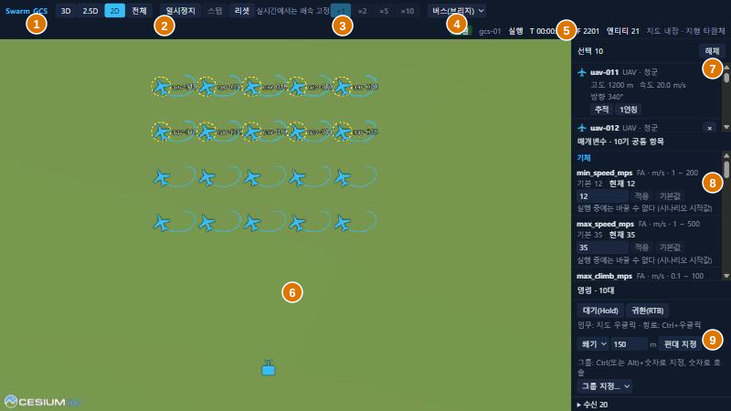
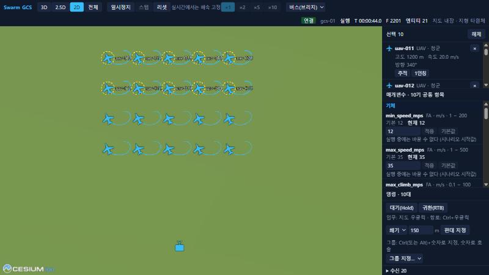
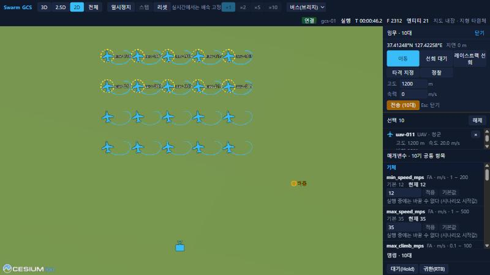
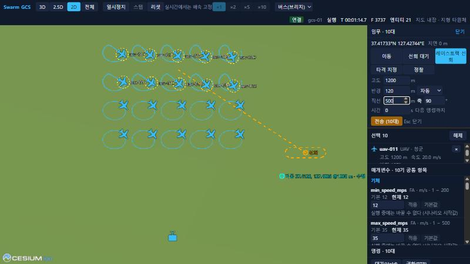
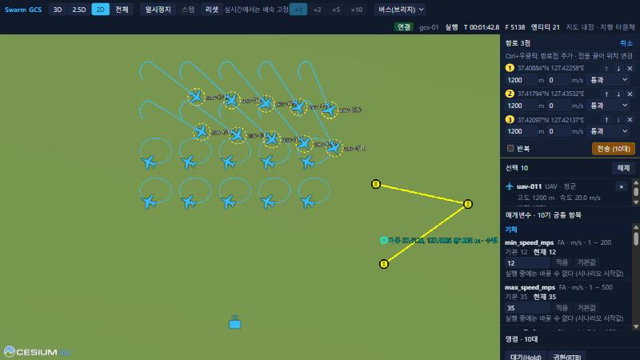
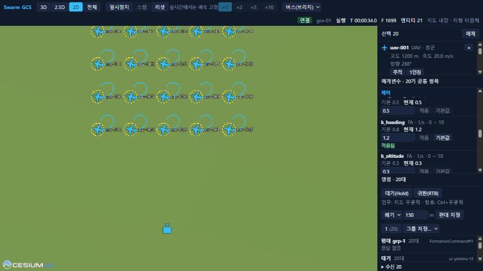
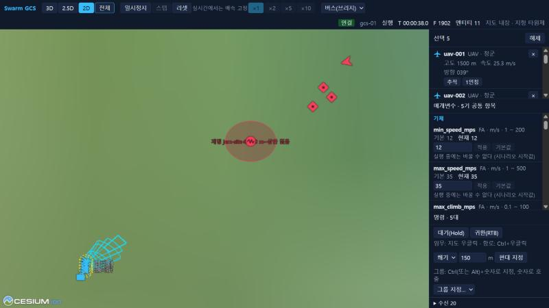

# 5. Operating the GCS UI

> Source: [docs/42_user/05_ui.md](../../42_user/05_ui.md) at commit `24fc9be`.

This is the screen in the browser where you view the map and give missions to vehicles. How to start it is in [chapter 2](02_quickstart.md). The UI is in Korean. Labels are written as shown on screen, with the English meaning in parentheses.

## 5.1 Screen layout

| No. | Area | Contents |
|---|---|---|
| 1 | View | `3D`, `2.5D`, `2D`, `전체` (Fit all: fits all entities in view) |
| 2 | Simulation control | `일시정지` (Pause)/`재개` (Resume), `시작` (Start), `스텝` (Step), `리셋` (Reset) |
| 3 | Rate | `×1`, `×2`, `×5`, `×10`. Fixed in realtime |
| 4 | Data source | `목 소스` (Mock source), `버스(브리지)` (Bus via bridge) |
| 5 | Status | Connection, GCS, run state, simulation time `T`, frame `F`, entity count, map data |
| 6 | Map | Entities and trails. Selected vehicles have a yellow ring |
| 7 | Selection panel | Status of selected vehicles, camera buttons |
| 8 | Parameter panel | Parameters of selected vehicles |
| 9 | Command panel | Hold, RTB, formation, group, status of sent commands |

The mission window and route window open at the top of the right panel, not on the map.

## 5.2 URL arguments

| Argument | Meaning |
|---|---|
| `source` | `mock` (default, works without a bus), `bus` |
| `bridge` | Bridge address. Default `ws://<page host>:8765/bus` |
| `gcs` | The GCS this UI is in charge of. If empty, it only observes and sends no commands |

Example: `http://localhost:5173/?source=bus&gcs=gcs-01&bridge=ws://127.0.0.1:8765/bus`

> Not implemented: role-based permissions (after P6, DEC-020). Only control and observation are distinguished today.

## 5.3 Selection

| Input | Action |
|---|---|
| Left click | Selects the nearest entity. Clears the selection on empty space |
| Left drag | Box selection. Selects blue air vehicles in the box |
| Shift + selection | Adds |
| Ctrl + selection | Toggles |
| Ctrl+A | Selects all blue air vehicles |
| Esc | Clears selection and tracking |

## 5.4 Mission window

After selecting vehicles, **right-click** the map to open the mission window. All selected vehicles are the assignees of one task. If you right-click on an enemy target, the target ID is shown as well.

| Tab | Inputs | Task sent |
|---|---|---|
| `이동` (Move) | Altitude, speed (0 keeps the current speed) | MoveTo |
| `선회 대기` (Loiter) | Altitude, radius, direction, time (0 means until the next command) | Hold |
| `레이스트랙 선회` (Racetrack) | Altitude, radius, direction, straight length, axis heading (clockwise from true north), time | Hold (racetrack) |
| `타격 지정` (Strike designation) | `유도 객체 종류` (Guided object type) (`aam_short`, `agm_short`, `fpv`). Target designation on an enemy, otherwise an aim point | Strike |
| `정찰` (Reconnaissance) | Altitude, circle radius | SearchArea |

When sent, the window closes and the status appears in the command panel. A destination marker stays on the map.

A racetrack uses the clicked point as the midpoint of the two circle centers. The closed curve is previewed on the map. The definition of the actual flight path is in [developer 5.2](../41_dev/05_fa_plugin.md#52-vi-control-modes).

## 5.5 Routes

Place route points in order with **Ctrl+right-click**. In the route window, change the altitude, speed and action (`통과` (Pass through), `선회 대기` (Loiter), `정찰` (Reconnaissance)) of each point, and reorder with `↑`, `↓`, `✕`. Left-drag a point on the map to move it. Turn on `반복` (Repeat) to loop endlessly.

- After `전송` (Send) the button changes to `다시 전송` (Resend), and sending again with the same task ID replaces the whole route.
- Reopen with `편집` (Edit) on the route row of the command panel.
- `취소` (Cancel) or Esc discards the edit.
- Among the baseline MAs, `flocking` rejects Route.

## 5.6 Command panel

| Control | Action |
|---|---|
| `대기(Hold)` or H | Orbits at the current position |
| `귀환(RTB)` (Return to base) | Returns to the starting position |
| Shape, spacing, `편대 지정` (Assign formation) | Sends FormationCommand with the first selected vehicle as leader |
| Ctrl+number or Alt+number, `그룹 지정…` (Assign group…) | Assigns the selection to a unit group. In Chrome, Ctrl+number switches tabs, so use Alt+number |
| Number | Recalls the group (selection) |
| Number twice quickly | Recalls and moves the camera to that group |

The list at the bottom shows sent commands and per-vehicle status.

| Display | Meaning |
|---|---|
| `수락` (Accepted) | ACCEPTED |
| `수행` (Executing) | EXECUTING |
| `완료` (Completed) | COMPLETED |
| `거부` (Rejected) | REJECTED. The reason follows in parentheses. Example: `거부 (unsupported task strike)` |
| `취소` (Cancelled) | CANCELLED. Also shown when a new command replaced an earlier one |
| `응답 없음` (No response) | No status report arrived. Normal for formation and group commands, because baseline MAs do not send status for them |

## 5.7 Parameters

When you select a vehicle, the parameter panel lists items by the airframe, control, guidance, behavior and decision layers.

- Change a value and press `적용` (Apply). When `적용됨` (Applied) appears next to the item, the vehicle has accepted the value.
- `기본값` (Default) returns to the default value.
- For an out-of-range value, the reason appears below the item and `적용` (Apply) is disabled.
- Items marked `실행 중에는 바꿀 수 없다` (cannot be changed during a run) are changed in the scenario.
- If several vehicles are selected, only items with the same name are merged and changed together.

> Not implemented: scenario editing in the UI. Write start values in the [scenario JSON](03_scenario.md).

## 5.8 Camera

| Input | Action |
|---|---|
| Wheel | Zoom |
| Right drag | Moves the camera (rotates in 3D) |
| Middle drag, Ctrl+right drag | Tilt |
| `추적` (Track) in the selection panel | Follows the vehicle |
| `1인칭` (First person) in the selection panel | Views from the vehicle's attitude |
| `전체` (Fit all) | Fits all entities in view |

> Not verified: right drag, middle drag and Ctrl+right drag could not be reproduced with the tools used for this check. They are written from the camera settings in the code.

## 5.9 Event display

| Display | Meaning |
|---|---|
| Side-colored circle or column | Jamming zone. The label shows the jammer and altitude range |
| Cyan pyramid edges | Sensor field of view. The footprint thickens where it touches the ground |
| Trail (orange, magenta) | Guided object in flight |
| Red circle | Effect range of an `impact` event |
| Gray dot | Destroyed entity |

## 5.10 Status display

| Display | Meaning |
|---|---|
| `연결` (Connected), `연결 중` (Connecting), `끊김` (Disconnected) | Bridge connection |
| `대기` (Idle), `적재` (Loaded), `실행` (Running), `정지` (Paused), `종료` (Stopped) | Core state. After `리셋` (Reset) it becomes `적재` (Loaded) and `시작` (Start) appears |
| `시뮬레이션 응답 없음` (Simulation not responding) | No Core status received for more than 3 seconds |
| Participant wait indicator | Waiting for lockstep participants |
| `재생` (Replay) | MCAP replay in progress. Start, pause, step and rate are disabled |
| `누락 프레임 N` (Missing frames N) | Number of frames skipped because display could not keep up with the replay |
| `지도 내장` (Built-in map), `지형 타원체` (Ellipsoid terrain) | No local tiles ([1.2](01_install.md#12-map-data-optional)) |

`스텝` (Step) is enabled only while paused and advances one frame.

## 5.11 Shortcuts

| Key | Action |
|---|---|
| Esc | Closes mission and route windows, then clears selection and tracking. Works even while the cursor is in an input field |
| Ctrl+A | Selects all blue air vehicles |
| H | Hold |
| Number | Recalls a group, twice to move there |
| Ctrl+number, Alt+number | Assigns a group |

Next: [6. Traffic Monitor](06_monitor.md).
