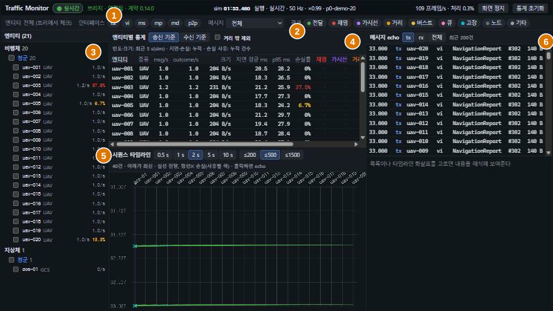
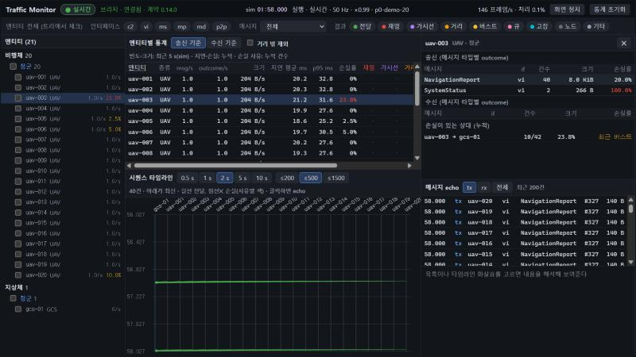
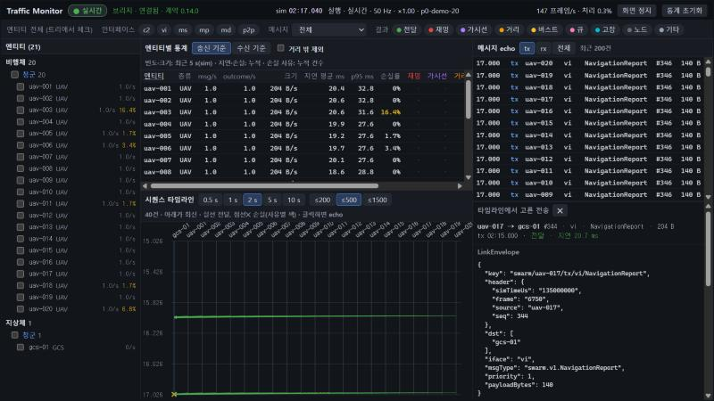

# 6. Traffic Monitor

> Source: [docs/42_user/06_monitor.md](../../42_user/06_monitor.md) at commit `7affdae`.

This screen aggregates and shows the messages passing through the datalink. It only observes and sends no commands. Pass `--monitor` to the runner to start it as well. The UI is in Korean. Labels are written as shown on screen, with the English meaning in parentheses.

Address: `http://localhost:5174/?source=bridge&url=ws://127.0.0.1:8765/bus`

| Argument | Meaning |
|---|---|
| `source` | `mock` (default, built-in mock traffic), `bridge` |
| `url` | Bridge address |
| `replay` | If `1`, shows replay until status arrives |
| `uavs`, `hz`, `rate` | Number of vehicles, broadcast period and rate of the mock source |

## 6.1 Screen layout

| No. | Area | Contents |
|---|---|---|
| 1 | Header | Live and replay badges, connection and contract version, simulation time and state, throughput, `화면 정지` (Freeze display), `통계 초기화` (Reset statistics) |
| 2 | Filter bar | Entity, interface, message type, result |
| 3 | Entity tree | Air vehicles and ground units → side → entity. Send rate and loss rate |
| 4 | Statistics table | Per-entity rate, size, latency, loss rate, counts by reason |
| 5 | Sequence timeline | Delivery and loss of messages in time order |
| 6 | Message echo | Recent message list and content decoding |

Other indicators in the header:

| Display | Meaning |
|---|---|
| Rewind count | Number of times the time went backward due to replay |
| Missing frames | Gaps in `truth/state` frame numbers |
| Unresponsive participants | Lockstep participants not responding |
| `링크 지연` (Link lag) | How far aggregation lags behind simulation time. Shown above 1 second |

## 6.2 Loss reasons

| Screen | Reason | Meaning |
|---|---|---|
| 재밍 (Jamming) | `JAMMED` | The receiver is inside a jamming zone |
| 가시선 (Line of sight) | `NO_LOS` | Blocked by terrain |
| 거리 (Range) | `OUT_OF_RANGE` | Insufficient range or SNR |
| 버스트 (Burst) | `BURST_LOSS` | Burst loss |
| 큐 (Queue) | `QUEUE_OVERFLOW` | Bandwidth queue exceeded |
| 고장 (Fault) | `FAULT_INJECTED` | Fault injection |
| 노드 (Node) | `NODE_DEAD` | The peer was destroyed |
| 기타 (Other) | Other | A value not in the contract |

How to create and remove the causes is in [chapter 7](07_link.md).

## 6.3 Aggregation definitions

| Value | Definition |
|---|---|
| msg/s, size | Moving window over the last 5 seconds of simulation time. Independent of replay rate |
| Latency mean, p95 | Cumulative |
| Loss rate | Loss outcomes / (deliveries + loss outcomes), cumulative |
| Counts by reason | Cumulative |

- The denominator is per-receiver outcomes. A broadcast counts as one loss for each same-side receiver it does not reach (DEC-032).
- `거리 밖 제외` (Exclude out of range) removes `OUT_OF_RANGE` from the numerator and denominator. Use it to drop pairs that are simply too far apart and look only at link quality.
- `송신 기준` (By sender) and `수신 기준` (By receiver) change the aggregation basis of the table.
- `통계 초기화` (Reset statistics) clears the cumulative values.

## 6.4 Filters

- The checkboxes in the entity tree are the entity filter. While in use, a scope selection (`송신 또는 수신` (Sender or receiver) and so on) appears at the top.
- Narrow down with the interface (`c2`, `vi`, `ms`, `mp`, `md`, `p2p`), message type and result chips.
- When filters are on, the bar grows to two rows and `필터 해제` (Clear filters) appears.
- Filters apply to the timeline and echo. Only the entity filter applies to the statistics table.
- Clicking a name in the tree opens the details, not the filter.

## 6.5 Details and timeline

Entity details show sends and receives per message type and the peers with losses.

In the timeline the lanes are entities and the newest is at the bottom. Delivery is a solid line, loss a dashed line in the reason's color with ✕. `0.5 s`~`10 s` change the window width and `≤200`~`≤1500` the display cap. Clicking an arrow decodes that message's LinkEnvelope and payload at the lower right.

Pressing `화면 정지` (Freeze display) changes the button to `화면 재개` (Resume display) and stops panel updates. The time in the header keeps moving. Data reception does not stop.

## 6.6 Replay

When replaying MCAP, the header badge becomes `재생 (MCAP)` (Replay) and the screen border turns orange. For missing frames and aggregation when replaying again, see [8.4](08_record_replay.md#84-screens-during-replay).

Next: [7. Creating datalink conditions](07_link.md).
