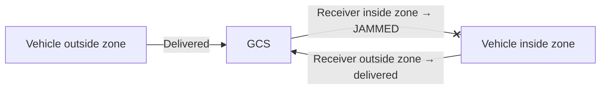

# 7. Creating datalink conditions

> Source: [docs/42_user/07_link.md](../../42_user/07_link.md) at commit `0a331b0`.

All vehicle-to-vehicle and ground-to-vehicle messages pass through the Datalink. Adjust latency, loss, bandwidth and jamming with the scenario and fault injection, and view the results in the Traffic Monitor.

## 7.1 Link profiles

An entity's `link_profile` names a profile. Built-in profiles:

| Name | Use | Characteristics |
|---|---|---|
| `default`, `uav_default` | Vehicles | 2.4 GHz, latency 20 ms, jitter 5 ms, 1 Mbps |
| `gcs_default` | GCS | Latency 50 ms, jitter 10 ms, 2 Mbps |
| `fpv_default` | Small air vehicles | 5.8 GHz, latency 10 ms, jitter 3 ms, 500 kbps |
| `ideal` | Tests | No range limit, latency or loss |

Add or change profiles with the top-level `link_profiles` in the scenario. It copies `base` and then overwrites only the fields written. If `base` is empty, it uses the built-in profile of the same name, or else `default`.

```json
"link_profiles": [
  { "name": "uav_slow", "base": "uav_default", "latency_ms": 80.0, "jitter_ms": 20.0 }
]
```

| Field | Meaning |
|---|---|
| `latency_ms`, `jitter_ms` | Fixed latency, normal jitter standard deviation |
| `bandwidth_bps`, `bucket_bytes`, `queue_len` | Token bucket fill rate (0 means unlimited), depth, waiting message cap (0 means unlimited) |
| `freq_mhz`, `tx_power_dbm`, `antenna_gain_dbi`, `noise_floor_dbm`, `snr_min_db` | Path loss and SNR evaluation |
| `max_range_m`, `unlimited_range` | Range cap (0 means SNR only), turn off range evaluation |
| `ge` | Gilbert-Elliott burst loss: `p_gb`, `p_bg`, `loss_good`, `loss_bad`. If present, all four values are overwritten |

## 7.2 Why messages disappear

The meaning of each reason is the same as in the Monitor's [loss reasons table](06_monitor.md#62-loss-reasons). For `NO_LOS`, the Datalink sees only flat terrain ([4.5](04_run.md#45-terrain-and-integrator)). `FAULT_INJECTED` is created with [7.4](#74-fault-injection).

## 7.3 Jamming zones

A jamming zone comes from `jammer` equipment. Attached to a `jammer_site` entity it becomes a fixed zone ([3.8](03_scenario.md#38-onboard-payloads-payloads)).



- It is receiver-based. A message sent from a vehicle inside the zone to outside the zone is delivered (DEC-028, DEC-055).
- A vehicle that carries the jammer is not jammed by its own zone when it receives. Other vehicles and GCSs inside the same zone are JAMMED regardless of side. Inside another vehicle's zone, the jammer's vehicle is JAMMED too (DEC-107).
- `link/state` shows jammed if either side is inside a zone. The own-zone exemption above applies here too.
- Frequency bands are not modeled.
- Zones are shown on the UI map as side-colored columns.

## 7.4 Fault injection

The UI has no fault injection button. Send faults to the running bus with a script.

```bash
uv run python qa/inject_fault.py --connect tcp/127.0.0.1:17601 --entity uav-003 --kind LINK_CUT --duration 10
```

- `--connect` is the listen address of a process on the bus. For the demo, `17601` (Datalink) works.
- `--duration` is in seconds. If omitted, the fault stays until cleared. To clear it, run the same command with `--clear`.

| `--kind` | Effect | Handling process |
|---|---|---|
| `LINK_CUT` | Cuts all links of the target | Datalink |
| `GCS_LINK_CUT` | Cuts only the link between the target and the GCS | Datalink |
| `ENGINE` | Speed command to minimum | Core |
| `NAV` | Stops navigation reports | Core |
| `SENSOR` | Stops detection, reports the sensor as inactive | Core |
| `KILL` | Destroys the entity | Core |

- It returns to normal when cleared or when the duration ends. Reset clears all faults.
- Faults are also reported to the GCS through health and subsystems of `SystemStatus`. Changes made while the link is cut do not arrive until the next change.

> Not implemented: peer relay (multi-hop). Messages are delivered only to directly reachable receivers.

### Vehicle behavior on link loss

The Datalink sends a `GcsHeartbeat` at 1 Hz from each GCS to the vehicles it controls (`controlling_gcs`). It goes through the same link evaluation as other messages, so it does not reach a vehicle that is jammed, cut off or out of range. Baseline MAs start watching after the first Heartbeat. When `lost_link_timeout_s` (default 5 s, simulation time) passes after the last one, they treat the link as lost and act on the policy (DEC-078).

| Policy | On loss | On recovery |
|---|---|---|
| `hold_until_command` (default) | Orbits in place. Task progress and the start of queued tasks stop | Keeps orbiting until a new command arrives |
| `resume_on_recovery` | Orbits in place | Resumes the interrupted task. With no task, returns to the flight before the loss |
| `continue` | Continues the task | No change |

- Set the policy per task with `lost_link_policy`. Without it, the MA parameter `lost_link_policy` applies ([chapter 3](03_scenario.md#37-mission-plan-mission_plan)).
- A new task command received while orbiting ends the orbit even before recovery, and the vehicle follows it.
- Recovery is not confirmed at once. After the Heartbeat returns it must keep arriving with gaps of at most `lost_link_recover_gap_s` (default 2 s) for `lost_link_recover_hold_s` (default 5 s) before recovery is accepted. Until then the link-loss behavior (orbit) continues (DEC-101, DEC-105). So with `resume_on_recovery` the task resumes about 5 s after the link returns (QA round 36 measured +5.00 s). If the Heartbeat is heard only now and then, as at a jamming edge, recovery can take longer even while the link is up.
- While the link is fully cut, the GCS cannot tell whether a vehicle is in the lost state (O-34). When the Heartbeat returns, the vehicle resends its current flight command status and the `TaskStatus` of tasks in progress to the GCS once (DEC-101). This re-report goes out right after the Heartbeat returns, so it can arrive before the MA confirms recovery.
- Each vehicle judges link loss from its own GCS Heartbeat and does not tell its peers. `flocking` peers are pulled briefly toward an orbiting vehicle by cohesion, then return to their own goal once outside the neighbor radius; a flock without a goal stays together. Formation followers follow the leader even when their own link is up, so when the leader orbits on link loss the whole formation orbits (O-37, by design).
- When the link comes back after a cut longer than `lost_link_timeout_s`, the vehicle sends its status reports (vehicle status, in-progress flight command status, store loadout, payload status) and flight capability once more. This keeps the GCS from missing changes made during the cut. Normal report volume is unchanged (DEC-089).
- Setting the policy from the UI or the Gateway has not been checked. Set it in the scenario.

## 7.5 Checking the results

Loss reasons appear in the statistics table and timeline of the Traffic Monitor. How to read the screens is in [chapter 6](06_monitor.md). Replay past runs with [chapter 8](08_record_replay.md) to view them on the same screens.

Next: [8. Recording and replay](08_record_replay.md).
