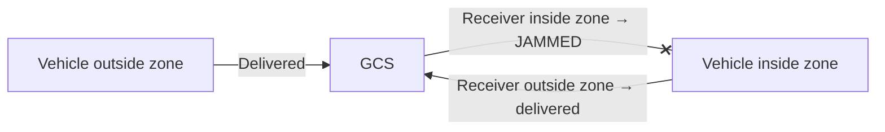

# 7. Creating datalink conditions

> Source: [docs/42_user/07_link.md](../../42_user/07_link.md) at commit `f7bcbac`.

All vehicle-to-vehicle and ground-to-vehicle messages pass through the Datalink. Adjust latency, loss, bandwidth and jamming with the scenario and fault injection, and view the results in the Traffic Monitor.

## 7.1 Link profiles

An entity's `link_profile` names a profile. Built-in profiles:

| Name | Use | Characteristics |
|---|---|---|
| `default`, `uav_default` | Vehicles | 2.4 GHz, latency 20 ms, jitter 5 ms, 1 Mbps |
| `gcs_default` | GCS | Latency 50 ms, jitter 10 ms, 2 Mbps |
| `fpv_default` | Small air vehicles | 5.8 GHz, latency 10 ms, jitter 3 ms, 500 kbps |
| `ideal` | Tests | No range limit, latency or loss |

Add or change profiles with the top-level `link_profiles` in the scenario. It copies `base` and then overwrites only the fields written. If `base` is empty, it uses the built-in profile of the same name, or else `default`.

```json
"link_profiles": [
  { "name": "uav_slow", "base": "uav_default", "latency_ms": 80.0, "jitter_ms": 20.0 }
]
```

| Field | Meaning |
|---|---|
| `latency_ms`, `jitter_ms` | Fixed latency, normal jitter standard deviation |
| `bandwidth_bps`, `bucket_bytes`, `queue_len` | Token bucket fill rate (0 means unlimited), depth, waiting message cap (0 means unlimited) |
| `freq_mhz`, `tx_power_dbm`, `antenna_gain_dbi`, `noise_floor_dbm`, `snr_min_db` | Path loss and SNR evaluation |
| `max_range_m`, `unlimited_range` | Range cap (0 means SNR only), turn off range evaluation |
| `ge` | Gilbert-Elliott burst loss: `p_gb`, `p_bg`, `loss_good`, `loss_bad`. If present, all four values are overwritten |

## 7.2 Why messages disappear

The meaning of each reason is the same as in the Monitor's [loss reasons table](06_monitor.md#62-loss-reasons). For `NO_LOS`, the Datalink sees only flat terrain ([4.5](04_run.md#45-terrain-and-integrator)). `FAULT_INJECTED` is created with [7.4](#74-fault-injection).

## 7.3 Jamming zones

A jamming zone comes from `jammer` equipment. Attached to a `jammer_site` entity it becomes a fixed zone ([3.8](03_scenario.md#38-onboard-payloads-payloads)).



- It is receiver-based. A message sent from a vehicle inside the zone to outside the zone is delivered (DEC-028, DEC-055).
- `link/state` shows jammed if either side is inside a zone.
- Frequency bands are not modeled.
- Zones are shown on the UI map as side-colored columns.

## 7.4 Fault injection

The UI has no fault injection button. Send faults to the running bus with a script.

```bash
uv run python qa/inject_fault.py --connect tcp/127.0.0.1:17601 --entity uav-003 --kind LINK_CUT --duration 10
```

- `--connect` is the listen address of a process on the bus. For the demo, `17601` (Datalink) works.
- `--duration` is in seconds. If omitted, the fault stays until cleared. To clear it, run the same command with `--clear`.

| `--kind` | Effect | Handling process |
|---|---|---|
| `LINK_CUT` | Cuts all links of the target | Datalink |
| `GCS_LINK_CUT` | Cuts only the link between the target and the GCS | Datalink |
| `ENGINE` | Speed command to minimum | Core |
| `NAV` | Stops navigation reports | Core |
| `SENSOR` | Stops detection, reports the sensor as inactive | Core |
| `KILL` | Destroys the entity | Core |

- It returns to normal when cleared or when the duration ends. Reset clears all faults.
- Faults are also reported to the GCS through health and subsystems of `SystemStatus`. Changes made while the link is cut do not arrive until the next change.

> Not implemented: vehicle behavior on link loss (roadmap P2). Baseline MAs continue the last task even if the link is cut.

> Not implemented: peer relay (multi-hop). Messages are delivered only to directly reachable receivers.

## 7.5 Checking the results

Loss reasons appear in the statistics table and timeline of the Traffic Monitor. How to read the screens is in [chapter 6](06_monitor.md). Replay past runs with [chapter 8](08_record_replay.md) to view them on the same screens.

Next: [8. Recording and replay](08_record_replay.md).
