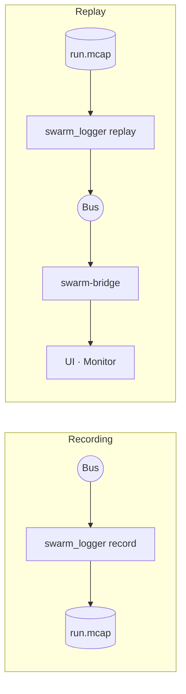

# 8. Recording and replay

> Source: [docs/42_user/08_record_replay.md](../../42_user/08_record_replay.md) at commit `bbf4d92`.

All bus messages are recorded to one MCAP file and published to the bus again at the original time intervals. During replay, UI and Monitor use the same screens as live.



## 8.1 Recording

The demo runner records by default (`out/p0_demo/live-<time>/p0_demo.mcap`). To turn it off, use `--no-record`.

To record yourself:

```bash
build/msvc-debug/logger/swarm_logger record --out run.mcap --no-multicast --listen tcp/127.0.0.1:17600
```

- `--key <expression>` records only some keys. The default is all.
- Stop with Ctrl+C. The Logger must close the file before it can be replayed.

## 8.2 Inspecting a file

```bash
build/msvc-debug/logger/swarm_logger info run.mcap
```

It shows the message count, time range and per-channel counts. Channels are the same as bus keys.

## 8.3 Replay

The runner starts the bridge and screens together.

```bash
uv run python scripts/run_p0_demo.py replay out/p0_demo/live-<time>/p0_demo.mcap --rate 3 --monitor
```

- UI: `http://localhost:5173/?source=bus&gcs=&bridge=ws://127.0.0.1:8765/bus`. Leave `gcs=` empty to block commands.
- Monitor: `http://localhost:5174/?source=bridge&url=ws://127.0.0.1:8765/bus`
- Core, Datalink and Agent are not started. It exits when finished. `--linger <seconds>` keeps the screens longer.

To check only the contents:

```bash
build/msvc-debug/logger/swarm_logger replay run.mcap --dry-run
```

- `--rate` is the rate, `--key` the keys to replay. `--dry-run` only counts without publishing to the bus. Bus options are the same as other executables.

## 8.4 Screens during replay

- `재생` (Replay) appears on the UI toolbar and start, pause, step and rate are disabled. The Monitor shows the `재생 (MCAP)` (Replay) badge (DEC-031).
- The replayer does not adapt to receiver speed. Frames missed by a receiver at high rate are counted as gaps in `truth/state` frame numbers and shown on screen (DEC-042).
- When replaying again with the same Monitor, aggregation is cleared at the point where the time goes backward by more than 5 s.

## 8.5 Size reference

Recording the 20-vehicle demo for about 25 seconds gave about 12 MB and about 58,000 messages. About 2 minutes gives about 300,000 messages. Size grows in proportion to vehicle count and time.

Next: [9. A-GRA Gateway](09_gateway.md).
