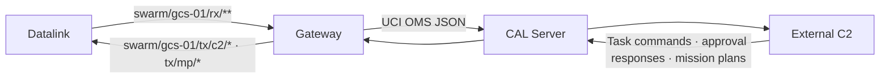
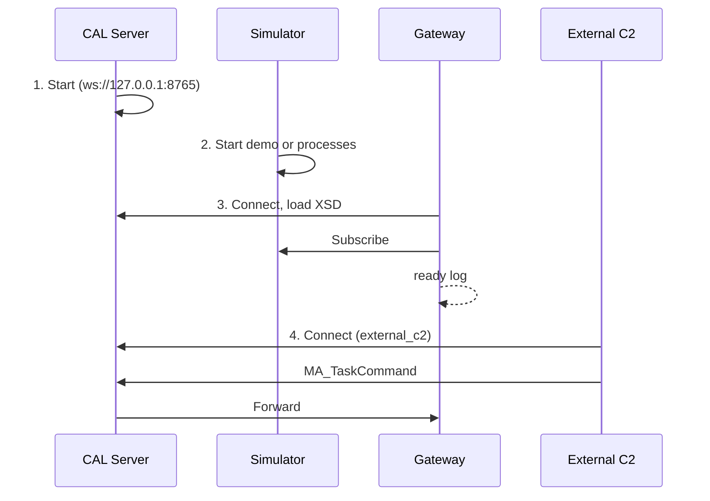

# 9. A-GRA Gateway

> Source: [docs/42_user/09_gateway.md](../../42_user/09_gateway.md) at commit `f7bcbac`.

Exchanges the simulator's GCS-side messages with external A-GRA systems. The Gateway communicates with external C2 through the CAL Server (DEC-068, DEC-069).



The full table of exchanged messages is in [gateway/README.md](../../../gateway/README.md#교환-메시지). It exports vehicle position (`MA_NavigationReport`, `MA_PositionReport`), task status (`MA_TaskStatus`) and flight command status (`MA_FlightCommandStatus`), and receives `MA_TaskCommand`, `MA_ApprovalRequestStatus`, `MA_RoutePlan` and `MA_MissionPlan`.

## 9.1 Preparation

```bash
git submodule update --init third_party/agra_lacal
```

```bash
cd gateway && uv sync --extra zenoh
```

> Caution: without `--extra zenoh`, the Gateway reports how to install it and exits with code 1. To check it without the simulator, pass `--bus memory` explicitly. In that case no simulator messages arrive.

## 9.2 Launch order



**1. Start the CAL Server.**

```bash
cd gateway && uv run python -m swarm_gateway.lacal_server --config config/lacal_server.yaml
```

**2. Start the simulator.** The CAL Server uses port 8765, so change the bridge port.

```bash
uv run python scripts/run_p0_demo.py live --bridge-port 8770
```

Also give the browser UI `ws://127.0.0.1:8770/bus` in `bridge=` of the URL.

**3. Start the Gateway.** `--no-multicast` and `--connect` attach it directly to the simulator bus.

```bash
cd gateway && uv run python -m swarm_gateway --gcs gcs-01 --lacal ws://127.0.0.1:8765 --no-multicast --connect tcp/127.0.0.1:17600 --connect tcp/127.0.0.1:17601
```

The ports in `--connect` follow the runner's `--base-port` (default 17600). `--participant <id>` is the Gateway's publisher ID (default `gateway-0`).

**4. Attach external C2.** Connect to the same CAL Server as the `external_c2` service and send `MA_TaskCommand` and `MA_ApprovalRequestStatus` on the `swarm.c2` topic, and `MA_RoutePlan` and `MA_MissionPlan` on the `swarm.mp` topic. A test client implementation is in [qa/gw_ext_client.py](../../../qa/gw_ext_client.py).

## 9.3 Right after start

The Gateway loads the XSD after connecting. It took about 9 seconds in a test run. Commands sent externally during that time are lost, since nobody is receiving them even though the server answers `+OK` (O-13). External C2 should send commands after the `ready` line appears.

| Log | Meaning |
|---|---|
| `LA-CAL connected ... not ready yet` | Connected only |
| `XSD loaded, mapping built` | Validation ready |
| `LA-CAL SUB MA_TaskCommand@swarm.c2 done` | External command subscription complete |
| `ready at +N s` | Ready in both directions |

## 9.4 External `MA_TaskCommand` rules

These rules are used only for tasks that need no position, and for cancel (DEC-076).

- One `Command` item is one executing vehicle.
- `CapabilityID.DescriptiveLabel` = `<entity ID>/<task kind>`.
- Only `hold` (loiter at the current position) and `return_to_base` are accepted as task kinds.
- `TaskID.DescriptiveLabel` becomes the internal task ID.
- `CommandState` of `CANCEL` means cancel.
- `TaskID` and `CommandState` must be the same in all items.

Tasks that need position information, such as a move destination, are received as mission plans in [9.6](#96-mission-plan-reception).

Sending `hold` yields `EXECUTION_PENDING` → `EXECUTING` in `MA_TaskStatus`. The vehicle's previous task becomes `CANCELED`.

## 9.5 External approval responses

`MA_ApprovalRequestStatus` is received on `swarm.c2` and sent as `ApprovalResponse` (DEC-075).

- Only messages with `RequestProcessingState` of `COMPLETED` and `ApprovalRequestProcessingState` of `APPROVED` or `REJECTED` are accepted. Other states are rejected.
- If the Gateway sent out the request, the response goes only to the requesting vehicle. For an unknown request (including after a restart), `dst` is left empty and receivers sort it out by `request_id`.

## 9.6 Mission plan reception

`MA_RoutePlan` and `MA_MissionPlan` are received on `swarm.mp` and sent as `RoutePlan` and `MissionPlan` (DEC-076). The full table of supported and rejected items is in [gateway/README.md](../../../gateway/README.md#임무-계획-수신-dec-076).

- Send `MA_RoutePlan` first, then the `MA_MissionPlan` that references that route. Received routes exist only in Gateway memory (latest 1024), so send them again after a restart.
- `MA_MissionPlan` becomes one task per referenced route. One route point gives `move_to`, two or more give `route`, and `task_id` is the route ID.
- The target is one `ApplicableToIDs/SystemID`. `ALL`, `NON` and `PackageID` are rejected (CR-GW-009).
- Tasks that cannot be expressed as a route, such as area search, cannot be received (CR-GW-007).

Baseline MAs reflect plans received during a run as follows.

| Received | Behavior |
|---|---|
| `MissionPlan` with a `plan_id` already seen | Ignored even if the content differs |
| `MissionPlan` with a new `plan_id` | Replaces. The executing task and waiting tasks become `CANCELLED` and the new plan is executed |
| `RoutePlan` with a plan task of the same ID (`waypoint`) | Not flown separately. That task executes it. In either sending order of `RoutePlan` and `MissionPlan`, it ends `COMPLETED` |
| Standalone `RoutePlan` not in a plan (`waypoint`) | Flown at once. The executing task becomes `CANCELLED`, and waiting tasks resume after the route. No task status comes for the `RoutePlan` itself |

- `flocking` rejects `route` tasks with two or more route points.
- `flocking` does not send `EXECUTING`, so the last value seen externally stays `EXECUTION_PENDING` (O-28).

## 9.7 Counters and rejection

A `counters` log appears every `--stats-s` period.

| Item | Meaning |
|---|---|
| `rx` | Messages received from the bus |
| `exported`, `exported.<UCI message>` | Number that passed XSD validation and were exported |
| `sent` | Number sent to LA-CAL |
| `ext_rx` | Commands received externally |
| `ext_published` | Commands published to the bus |

- Messages failing XSD validation or conversion are not exported and are recorded in logs and counters. The Gateway keeps running.
- Even if one position mapping message fails, the other mapped messages are exported.

> Known limitation: `declared.pub` in `config/lacal_server.yaml` lacks `MA_PositionReport` (O-20). In a test run the messages were forwarded anyway.

> In lockstep, external input breaks same-seed reproduction. The Gateway publishes at the tick in which the input arrived, so the trajectories of the vehicles that received it differ between runs. Without external input, trajectories, link results and GCS receptions match.

Next: [10. Troubleshooting](10_faq.md).
