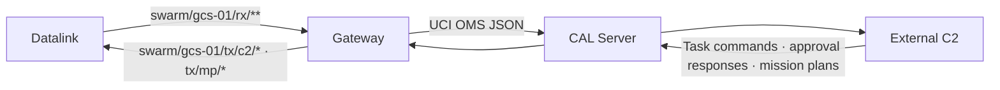
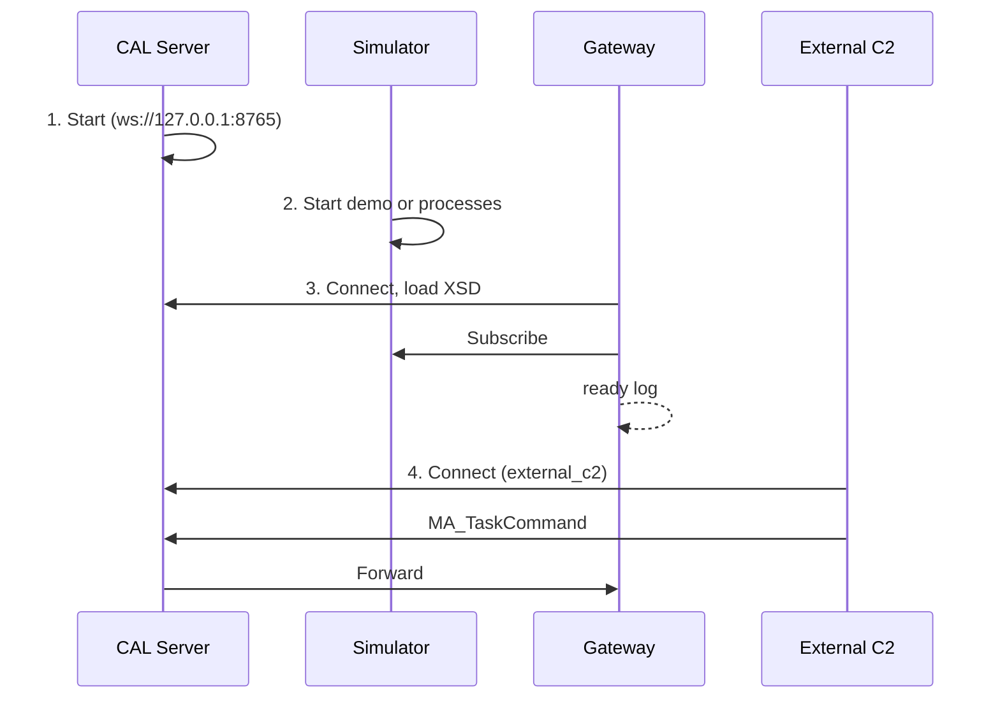

# 9. A-GRA Gateway

> Source: [docs/42_user/09_gateway.md](../../42_user/09_gateway.md) at commit `f767bb5`.

Exchanges the simulator's GCS-side messages with external A-GRA systems. The Gateway communicates with external C2 through the CAL Server (DEC-068, DEC-069).



The full table of exchanged messages is in [gateway/README.md](../../../gateway/README.md#교환-메시지). It exports vehicle position (`MA_NavigationReport`, `MA_PositionReport`), task status (`MA_TaskStatus`), flight command status (`MA_FlightCommandStatus`), and the approval requests (`MA_ApprovalRequest`), leader changes (`MA_LeaderUpdateRequest`), shared detections (`MA_Entity`) and store loadout (`StoreLoadoutConfiguration`, DEC-088) sent by vehicles, and receives `MA_TaskCommand`, `MA_ApprovalRequestStatus`, `MA_RoutePlan` and `MA_MissionPlan`.

## 9.1 Preparation

```bash
git submodule update --init third_party/agra_lacal
```

```bash
cd gateway && uv sync --extra zenoh
```

> Caution: without `--extra zenoh`, the Gateway reports how to install it and exits with code 1. Also add `--extra zenoh` when you sync again after updating the repository. A `uv sync` without it removes zenoh and the Gateway cannot start (QA round 39). To check it without the simulator, pass `--bus memory` explicitly. In that case no simulator messages arrive.

## 9.2 Launch order



**1. Start the CAL Server.**

```bash
cd gateway && uv run python -m swarm_gateway.lacal_server --config config/lacal_server.yaml
```

**2. Start the simulator.** The CAL Server uses port 8765, so change the bridge port.

```bash
uv run python scripts/run_p0_demo.py live --bridge-port 8770
```

Also give the browser UI `ws://127.0.0.1:8770/bus` in `bridge=` of the URL.

**3. Start the Gateway.** `--no-multicast` and `--connect` attach it directly to the simulator bus.

```bash
cd gateway && uv run python -m swarm_gateway --gcs gcs-01 --lacal ws://127.0.0.1:8765 --no-multicast --connect tcp/127.0.0.1:17600 --connect tcp/127.0.0.1:17601
```

The ports in `--connect` follow the runner's `--base-port` (default 17600). `--participant <id>` is the Gateway's publisher ID (default `gateway-0`).

| Option | Meaning |
|---|---|
| `--sim-epoch <UTC>` | Fixes the epoch of UCI times. ISO 8601 with a required time zone (for example `2026-01-01T00:00:00Z`). Takes precedence over the scenario value. For reproducible tests. Normally leave it out and use the scenario value ([UCI time](#uci-time)) |
| `--lacal-admin <url>` | CAL Server admin address. Default is port 8766 on the `--lacal` host. Used to detect new external subscriptions and send them the last values. `none` turns it off |
| `--envelope on\|off` | External exchange envelope. Default `on` ([envelope](#external-exchange-envelope)). `off` exchanges UCI messages without an envelope and uses `config/lacal_server_raw.yaml` for the CAL Server |
| `--envelope-dest <UUID>` | Destination of sent envelopes (external system UUID). Repeatable. Left out if empty |
| `--transport lacal\|stomp` | External transport. Default `lacal`. `stomp` is the A-GRA test harness bus ([test harness](#test-harness-stomp-path)) |
| `--scenario-query-attempts <n>` | Number of scenario queries at start, default 5. 0 means no query (DEC-109) |

All options are in [gateway/README.md](../../../gateway/README.md) (Korean).

Launch order: the Gateway queries Core for the scenario at start (contract 0.24.0, DEC-109), so even if started after the simulator it knows the known vehicles and the UCI epoch at once. However, task status and approval requests go out only when they change, so a Gateway started late cannot give external systems the current state of tasks started before it, and external systems cannot answer approval requests made before it. In operation, start the Gateway before the simulator (OPN-095, open).

**4. Attach external C2.** Connect to the same CAL Server as the `external_c2` service and send `MA_TaskCommand`, `MA_ApprovalRequestStatus` and `QueryDataRequest` on the `swarm.c2` topic, and `MA_RoutePlan` and `MA_MissionPlan` on the `swarm.mp` topic. In the default run with the envelope on, wrap these messages in `MA_RxDataPayload`, and receive the Gateway's messages by unwrapping `MA_TxDataPayloadCommand` on each topic. A test client implementation is in [qa/gw_ext_client.py](../../../qa/gw_ext_client.py).

## 9.3 Right after start

The Gateway subscribes to external commands as soon as it connects to the CAL Server. It then loads the XSD (about 4 s) and takes scenario and received reports from the bus for 1.5 s. External messages received during that time are queued in arrival order, up to 256, and processed once ready (IMP-GW-034). Queued commands go out at most about 6 s after they were received.

| Log | Meaning |
|---|---|
| `LA-CAL connected ... at +N s` | Connected |
| `LA-CAL SUB MA_TaskCommand@swarm.c2 done` | External command subscription complete. From here external messages are not lost |
| `XSD loaded, mapping built` | Validation ready |
| `ready at +N s: ...; K external messages held, processed after 1.5 s settle` | Ready in both directions. The K queued messages are processed after 1.5 s |
| `pre-ready <message> held N s -> <result>` | A queued message was processed |
| `no scenario after N queries` | The scenario query at start got no answer. The Gateway waits for it on the subscription |

- When the Gateway restarts, commands sent externally between the old Gateway ending and the new subscription (about 1.1 s measured) are lost. The CAL Server answers `+OK` but does not keep them. In the restart measurement this was 2 to 3 per restart (10 to 11 before the fix). The Gateway cannot receive in this window, so external C2 waits for `MA_TaskStatus` for each command and resends if none comes (O-13).

## 9.4 External `MA_TaskCommand` rules

These rules are used only for tasks that need no position, and for cancel (DEC-076).

- One `Command` item is one executing vehicle.
- `CapabilityID.DescriptiveLabel` = `<entity ID>/<task kind>`.
- Only `hold` (loiter at the current position) and `return_to_base` are accepted as task kinds.
- `TaskID.DescriptiveLabel` becomes the internal task ID.
- `CommandState` of `CANCEL` means cancel.
- `TaskID` and `CommandState` must be the same in all items.

Tasks that need position information, such as a move destination, are received as mission plans in [9.6](#96-mission-plan-reception).

Sending `hold` yields `EXECUTION_PENDING` → `EXECUTING` in `MA_TaskStatus`. The vehicle's previous task becomes `CANCELED`.

## 9.5 External approval responses

`MA_ApprovalRequestStatus` is received on `swarm.c2` and sent as `ApprovalResponse` (DEC-075).

- Approval requests on the vehicle side are turned on with the MA variable `approval_tasks` ([3.6](03_scenario.md#36-autonomy-plugins-autonomy)). Requests go out as `MA_ApprovalRequest`, and `RespondBy` is the report time plus the approval wait time.
- Only messages with `RequestProcessingState` of `COMPLETED` and `ApprovalRequestProcessingState` of `APPROVED` or `REJECTED` are accepted. Other states are rejected.
- If the Gateway sent out the request, the response goes only to the requesting vehicle. For an unknown request (including after a restart), `dst` is left empty and receivers sort it out by `request_id`.

## 9.6 Mission plan reception

`MA_RoutePlan` and `MA_MissionPlan` are received on `swarm.mp` and sent as `RoutePlan` and `MissionPlan` (DEC-076). The full table of supported and rejected items is in [gateway/README.md](../../../gateway/README.md#임무-계획-수신-dec-076).

- Send `MA_RoutePlan` first, then the `MA_MissionPlan` that references that route. Received routes exist only in Gateway memory (latest 1024), so send them again after a restart.
- `MA_MissionPlan` becomes one task per referenced route. One route point gives `move_to`, two or more give `route`, and `task_id` is the route ID.
- The target is one `ApplicableToIDs/SystemID`. `ALL`, `NON` and `PackageID` are rejected (CR-GW-009).
- Tasks that cannot be expressed as a route, such as area search, cannot be received (CR-GW-007).

Baseline MAs reflect plans received during a run as follows.

| Received | Behavior |
|---|---|
| `MissionPlan` with a `plan_id` already seen | Ignored even if the content differs |
| `MissionPlan` with a new `plan_id` | Replaces. The executing task and waiting tasks become `CANCELLED` and the new plan is executed |
| `RoutePlan` with a plan task of the same ID (`waypoint`) | Not flown separately. That task executes it. In either sending order of `RoutePlan` and `MissionPlan`, it ends `COMPLETED` |
| Standalone `RoutePlan` not in a plan (`waypoint`) | Flown at once. The executing task becomes `CANCELLED`, and waiting tasks resume after the route. No task status comes for the `RoutePlan` itself |

- `flocking` rejects `route` tasks with two or more route points.
- `flocking` also sends `EXECUTING` on the tick after acceptance, like the other baseline MAs (IMP-AGT-057, O-28 resolved).

### State and time sent to external systems

These are the rules external systems see. Details are in [gateway/README.md](../../../gateway/README.md#늦게-붙은-외부-시스템-dec-089) (Korean).

#### External systems that join late

- Change reports (vehicle status, flight capability, payload status, store loadout, task status) go out only when the value changes. The Gateway keeps the last value and sends it once more when an external system newly subscribes to that message (DEC-089).
- Periodic reports such as position, approval requests, leader changes, shared detections and flight command status are not resent.
- A resent value also reaches existing subscribers of the same topic once more. After a Gateway restart there are no kept values.
- External state values follow the public XSD enums. `MA_FlightCommandStatus` has no executing or completed value, so those show as `ACCEPTED`. Read execution and completion from `MA_TaskStatus` (DEC-090).

#### Command state

- `MA_FlightCommandStatus` follows the UCI Command-2 state machine. `ACCEPTED`, `REJECTED` and `CANCELED` are end states (DEC-097).
- After an end state has been sent once for a vehicle's `CommandID`, no more states are sent for that ID. Repeated `RECEIVED` is not sent either. The blocked count is in the counter `skipped_command_state`.
- The first report is always sent. A command replaced before acceptance can have `CANCELED` as its first report.
- After a Gateway restart it does not remember finished IDs, so the same end state can go out at most once more per ID.

#### UCI time

The UCI header `Timestamp` and the position, velocity and attitude times are not wall-clock times but the UTC of the message's simulation time. UTC = epoch + simulation time, and the epoch is chosen in this order (DEC-098).

1. `--sim-epoch`. It does not change when a scenario value arrives.
2. The scenario's `run.epoch_utc`. If not written, the value Core filled in ([3.4](03_scenario.md#34-map-run)). This is the usual case.
3. The first message that arrives before the scenario: the wall clock at that time minus its simulation time. The warning log `no scenario epoch yet` appears.

- If the epoch was set by 3 and a scenario value then arrives, the Gateway switches to the scenario value. The warning log `UCI time base changed` and the counter `epoch_changed` record it. A different value in a new scenario is handled the same way.
- Within one epoch, (Timestamp − simulation time) stays constant through pause and rate changes.

#### Commands that name unknown vehicles

- If any vehicle named by an external `MA_TaskCommand`, `MA_RoutePlan` or `MA_MissionPlan` is unknown, the Gateway does not publish it to the bus and rejects it (D-35). The warning log `unknown entity [...]` and the counter `ext_rejected` record it.
- Known vehicles are the UAVs in the scenario (`sim/ctrl/scenario`, which the Gateway only reads) and the vehicles this GCS has received reports from. Truth is not used (DEC-096).
- When an `MA_TaskCommand` or `MA_MissionPlan` is rejected, the Gateway sends an `MA_TaskStatus` (`DROPPED`, with the reason) for each unknown vehicle to inform the external side. `MA_RoutePlan` has no status message to report with, so only the rejection is recorded.

### External exchange envelope

External interface (MA-C2) messages travel wrapped in an envelope (DEC-111, on by default). Detailed rules are in [gateway/README.md](../../../gateway/README.md#외부-교환-봉투-dec-111) (Korean).

- Receive: the UCI XML document in the `EncodedPayload` of `MA_RxDataPayload` is unwrapped and handled as usual. Both the envelope and the inner message are validated against the XSD.
- Messages are received only when the destination (`SpecificDestinationID`) is empty or contains the Gateway system UUID. Otherwise they are ignored (counter `envelope_not_addressed`).
- Send: wrapped in `MA_TxDataPayloadCommand`. The destination is given with `--envelope-dest`.
- With the envelope on, messages without an envelope are not received (`envelope required`). Strings inside the envelope are ASCII. Non-ASCII characters in outgoing strings are replaced (`envelope_ascii_replaced`).

### Query responses (QueryDataRequest)

The Gateway answers an external `QueryDataRequest` with the latest value per vehicle of messages it has already exported (DEC-112). It does not ask MAs or runtimes.

- When handled it sends `QueryDataRequestStatus` `PROCESSING`, then `COMPLETED` (latest values in the result). If `ResultsPerPage` is smaller than the result count, it sends one `COMPLETED` per page.
- Message kinds it does not export and conditional queries are refused with a single `REJECTED` carrying the reason.
- `CANCEL` has nothing to cancel. An unknown `RequestID` gets `REJECTED`; a finished one gets its end state once more.
- Detailed rules are in the exchange messages section of [gateway/README.md](../../../gateway/README.md) (Korean).

### Test harness STOMP path

A second transport that attaches directly to the A-GRA test harness bus (ActiveMQ STOMP 1.2) (DEC-110). Conversion, validation, envelope and known-vehicle checks are the same as on the LA-CAL path. Options and an example are in [gateway/README.md](../../../gateway/README.md#시험-하네스-stomp-경로-dec-110) (Korean).

- Give `--transport stomp`, `--stomp <host:port>`, our platform UUID `--system-uuid` and the C2 UUID `--envelope-dest`. A 5.0a harness uses `--schema-version 005.0a.ASK`; then `MA_NavigationReport` and `MA_Entity`, which 5.0a lacks, are not exported.
- Harness topics are not retained, so start the Gateway before the harness.
- The harness start and stop signals are answered with the same `RequestID` (start `COMPLETED`, stop `CANCELED`).
- Harness code, XSDs and images are not put in the repository, because the distribution terms have not been confirmed (OPN-094, open). Harness tests can be run only on a PC where the harness is installed separately.
- The real-harness query test (23 MA/C2 `common_query_data` cases) gave 0/23 with the harness default seed and 23/23 with another seed. The requests built from the default seed's random values turn into cancel (`CANCEL`) requests ([gateway/TRACE.md](../../../gateway/TRACE.md), Korean).

## 9.7 Counters and rejection

A `counters` log appears every `--stats-s` period.

| Item | Meaning |
|---|---|
| `rx` | Messages received from the bus |
| `exported`, `exported.<UCI message>` | Number that passed XSD validation and were exported |
| `sent` | Number sent to LA-CAL |
| `ext_rx` | Commands received externally |
| `ext_published` | Commands published to the bus |
| `ext_rejected` | External commands rejected because they named an unknown vehicle |
| `skipped_command_state` | Command states not sent because they came after an end state |
| `replayed` | Values resent to late external subscribers |
| `epoch_changed` | Times the UCI epoch was switched to the scenario value |
| `scenario_query`, `scenario_by_query`, `scenario_by_subscription` | Scenario queries at start, and the path the scenario arrived by |
| `envelope_tx`, `envelope_rx`, `envelope_not_addressed`, `envelope_invalid` | Envelopes sent and received, ignored because not addressed to us, format errors |
| `query_rx`, `query.COMPLETED`, `query.REJECTED` | Queries received and responses by state |

- Messages failing XSD validation or conversion are not exported and are recorded in logs and counters. The Gateway keeps running.
- Even if one position mapping message fails, the other mapped messages are exported.

> In lockstep, external input breaks same-seed reproduction. The Gateway publishes at the tick in which the input arrived, so the trajectories of the vehicles that received it differ between runs. Without external input, trajectories, link results and GCS receptions match.

Next: [10. Troubleshooting](10_faq.md).
