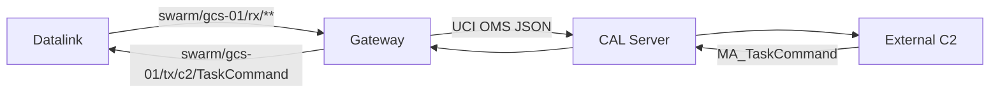
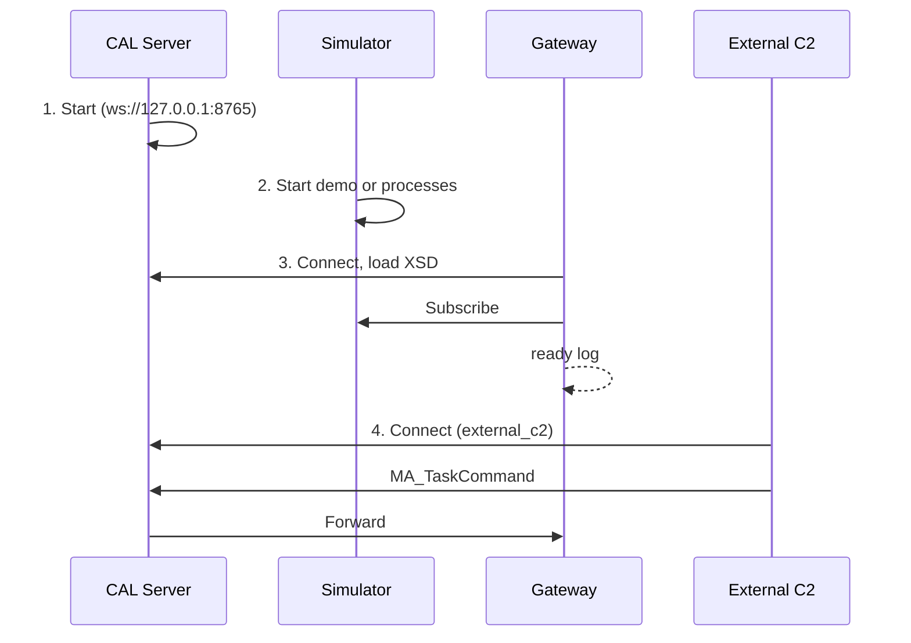

# 9. A-GRA Gateway

> Source: [docs/42_user/09_gateway.md](../../42_user/09_gateway.md) at commit `7affdae`.

Exchanges the simulator's GCS-side messages with external A-GRA systems. The Gateway communicates with external C2 through the CAL Server (DEC-068, DEC-069).



The full table of exchanged messages is in [gateway/README.md](../../../gateway/README.md#교환-메시지). It exports vehicle position (`MA_NavigationReport`, `MA_PositionReport`), task status (`MA_TaskStatus`) and flight command status (`MA_FlightCommandStatus`), and receives `MA_TaskCommand`.

## 9.1 Preparation

```bash
git submodule update --init third_party/agra_lacal
```

```bash
cd gateway && uv sync --extra zenoh
```

> Caution: without `--extra zenoh`, the Gateway starts on the in-memory bus. It runs without error and reaches `ready`, but no simulator messages arrive at all. If the `counters` log has no `rx`, suspect this first.

## 9.2 Launch order



**1. Start the CAL Server.**

```bash
cd gateway && uv run python -m swarm_gateway.lacal_server --config config/lacal_server.yaml
```

**2. Start the simulator.** The CAL Server uses port 8765, so change the bridge port.

```bash
uv run python scripts/run_p0_demo.py live --bridge-port 8770
```

Also give the browser UI `ws://127.0.0.1:8770/bus` in `bridge=` of the URL.

**3. Start the Gateway.** `--no-multicast` and `--connect` attach it directly to the simulator bus.

```bash
cd gateway && uv run python -m swarm_gateway --gcs gcs-01 --lacal ws://127.0.0.1:8765 --no-multicast --connect tcp/127.0.0.1:17600 --connect tcp/127.0.0.1:17601
```

The ports in `--connect` follow the runner's `--base-port` (default 17600).

**4. Attach external C2.** Connect to the same CAL Server as the `external_c2` service and send `MA_TaskCommand` on the `swarm.c2` topic. An example of a test client implementation is [qa/gw_ext_client.py](../../../qa/gw_ext_client.py).

## 9.3 Right after start

The Gateway loads the XSD after connecting. It took about 9 seconds in this check. Commands sent externally during that time are lost, since nobody is receiving them even though the server answers `+OK` (O-13). External C2 should send commands after the `ready` line appears.

| Log | Meaning |
|---|---|
| `LA-CAL connected ... not ready yet` | Connected only |
| `XSD loaded, mapping built` | Validation ready |
| `LA-CAL SUB MA_TaskCommand@swarm.c2 done` | External command subscription complete |
| `ready at +N s` | Ready in both directions |

## 9.4 Interim rules for external C2

These are interim rules until mission planning is integrated (CR-GW-003, OPN-062 open).

- One `Command` item is one executing vehicle.
- `CapabilityID.DescriptiveLabel` = `<entity ID>/<task kind>`.
- Only `hold` (loiter at the current position) and `return_to_base` are accepted as task kinds.
- `TaskID.DescriptiveLabel` becomes the internal task ID.
- `CommandState` of `CANCEL` means cancel.
- `TaskID` and `CommandState` must be the same in all items.

Tasks that need position information, such as a move destination, cannot be accepted yet.

The flow of `MA_TaskStatus` is as follows. Sending `hold` yields `EXECUTION_PENDING` → `EXECUTING`. The vehicle's previous task becomes `CANCELED`.

## 9.5 Counters and rejection

A `counters` log appears every `--stats-s` period.

| Item | Meaning |
|---|---|
| `rx` | Messages received from the bus |
| `exported`, `exported.<UCI message>` | Number that passed XSD validation and were exported |
| `sent` | Number sent to LA-CAL |
| `ext_rx` | Commands received externally |
| `ext_published` | Commands published to the bus |

- Messages failing XSD validation or conversion are not exported and are left in logs and counters. The Gateway keeps running.
- Even if one position mapping message fails, the other mapped messages are exported.

> Known limitation: `declared.pub` in `config/lacal_server.yaml` lacks `MA_PositionReport` (O-20). In this check the messages were forwarded anyway.

Next: [10. Troubleshooting](10_faq.md).
