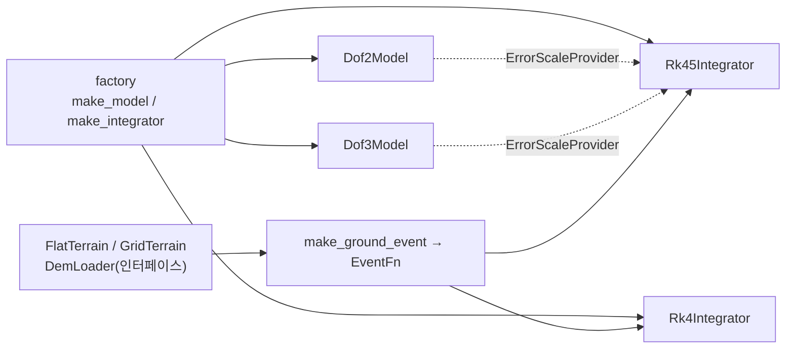

# WP2 동역학 추적표 (DYN)

- 범위: `dynamics/`. `api/cpp/include/swarm/api/dynamics.hpp`(IMP-API-006) 구현.
- 라이브러리 타깃 `swarm_dynamics`, 시험 실행 파일 `swarm_dynamics_tests`(CTest 이름 `dyn.TC-DYN-NNN`).

## 구조

## 구현 항목 (IMP)

| ID | 내용 | 위치 | 근거 |
|---|---|---|---|
| IMP-DYN-001 | 2-DoF 유니사이클. 상태 [lat, lon, alt, V, ψ, ψ̇, ḣ], 입력 KinematicCmd(speed, heading_rate, climb_rate), 1차 지연 추종. 자세는 ψ, 비행경로각, 협조선회 뱅크 atan(V·ψ̇/g) | `include/swarm/dyn/models.hpp`, `src/models.cpp` | REQ-DYN-001, REQ-DYN-002, PRP-DYN-001 |
| IMP-DYN-002 | 3-DoF 질점 협조선회. 상태 [lat, lon, alt, V, ψ, γ, φ], 입력 KinematicCmd(speed, bank, climb_rate), ψ̇ = g·tanφ/(V·cosγ). 자세는 (ψ, γ, φ) | `include/swarm/dyn/models.hpp`, `src/models.cpp` | REQ-DYN-001, REQ-DYN-002, PRP-DYN-001 |
| IMP-DYN-003 | RK4 고정 스텝(프레임당 스텝 수는 `max_step_s`로 설정) | `include/swarm/dyn/integrators.hpp`, `src/integrators.cpp` | REQ-DYN-004, DEC-005 |
| IMP-DYN-004 | RK45 Dormand-Prince 5(4) 프레임 안 가변 스텝(rtol/atol, 성분별 허용치 가중 `ErrorScaleProvider`). 두 적분기 공통으로 EventFn 영점 교차를 이분법으로 찾아 교차 직후 시점에서 멈춤 | `include/swarm/dyn/integrators.hpp`, `src/integrators.cpp` | REQ-DYN-003, REQ-DYN-004, DEC-005, PRP-DYN-002 |
| IMP-DYN-005 | 평지, 위경도 격자 DEM 쌍선형 보간, 한반도 DEM 로더 인터페이스(`DemLoader`, 구현 없음), 지면 교차 이벤트 `make_ground_event` | `include/swarm/dyn/terrain.hpp`, `src/terrain.cpp` | REQ-SIM-003, DEC-004, DEC-005, DEC-016 |
| IMP-DYN-006 | 모델·적분기 팩토리(이름·DynamicsKind → 인스턴스, 파라미터 재정의). dof5/dof6은 자리만(nullptr) | `include/swarm/dyn/factory.hpp`, `src/factory.cpp` | REQ-DYN-001, REQ-DYN-004 |

## 시험 (TC)

| ID | 내용 | 위치 | 근거 | 결과 |
|---|---|---|---|---|
| TC-DYN-001 | 2-DoF 등속·일정 상승의 해석해 비교(적도 동진, 경도 = (V/c)·ln((a+h₀+cT)/(a+h₀))), RK4·RK45 | `tests/test_dynamics.cpp` | IMP-DYN-001, IMP-DYN-003, IMP-DYN-004 | 통과 (msvc-debug, 2026-11-01) |
| TC-DYN-002 | 2-DoF 정상 선회 반경 V/ψ̇, 한 바퀴 폐합 | `tests/test_dynamics.cpp` | IMP-DYN-001 | 통과 (msvc-debug, 2026-11-01) |
| TC-DYN-003 | 3-DoF 정상 협조선회 반경 v²/(g·tanφ), 폐합, 선회율 | `tests/test_dynamics.cpp` | IMP-DYN-002 | 통과 (msvc-debug, 2026-11-01) |
| TC-DYN-004 | RK4 전역 오차 차수 ≈ 4 (조화 진동자, 측정 4.000) | `tests/test_dynamics.cpp` | IMP-DYN-003 | 통과 (msvc-debug, 2026-11-01) |
| TC-DYN-005 | RK45(Dormand-Prince) 고정 스텝 전역 오차 차수 ≈ 5 (측정 5.015) | `tests/test_dynamics.cpp` | IMP-DYN-004 | 통과 (msvc-debug, 2026-11-01) |
| TC-DYN-006 | RK45 가변 스텝: 허용치 강화 시 오차 감소, 프레임 안 세분, 추정 오차 ≤ 1 | `tests/test_dynamics.cpp` | IMP-DYN-004 | 통과 (msvc-debug, 2026-11-01) |
| TC-DYN-007 | 이벤트 시점 정확도(cos t = 0 → π/2, 오차 < 1e-8 s), 표면에서 시작 시 미발생 | `tests/test_dynamics.cpp` | IMP-DYN-003, IMP-DYN-004 | 통과 (msvc-debug, 2026-11-01) |
| TC-DYN-008 | 지면 교차: 평지 하강(t = 5 s), 경사 격자 지형 수평 비행 충돌 시각 | `tests/test_dynamics.cpp` | IMP-DYN-004, IMP-DYN-005 | 통과 (msvc-debug, 2026-11-01) |
| TC-DYN-009 | map_control: Kinematic 외 형식·빈 명령이면 false, 2-DoF는 heading_rate, 3-DoF는 bank 사용 | `tests/test_dynamics.cpp` | IMP-DYN-001, IMP-DYN-002 | 통과 (msvc-debug, 2026-11-01) |
| TC-DYN-010 | 격자 쌍선형 보간(평면 재현, 안장), 격자 밖 값, 크기 불일치 예외, 평지 | `tests/test_dynamics.cpp` | IMP-DYN-005 | 통과 (msvc-debug, 2026-11-01) |
| TC-DYN-011 | to_kinematic/from_kinematic 왕복, NED 속도, 쿼터니언(방위·비행경로각·뱅크) | `tests/test_dynamics.cpp` | IMP-DYN-001, IMP-DYN-002 | 통과 (msvc-debug, 2026-11-01) |
| TC-DYN-012 | 팩토리: 이름·DynamicsKind 생성, 예약 모델 nullptr, 파라미터 재정의, 모르는 파라미터 예외 | `tests/test_dynamics.cpp` | IMP-DYN-006 | 통과 (msvc-debug, 2026-11-01) |

## 제약과 계약 변경 요청

- 바람 미반영: `to_kinematic`이 `Environment`를 받지 않아 대지 속도를 낼 수 없다. 위치 적분과 출력 속도를 일치시키려고 바람을 넣지 않았다.
  계약 변경 요청: `to_kinematic`에 `const Environment&` 추가, 또는 대기 속도와 대지 속도를 구분한 `KinematicSample` 필드 추가.
- 3-DoF `to_kinematic`의 각속도는 표준 중력으로 계산한다(같은 이유).
- 적분기 인스턴스는 작업 버퍼를 가진다. 스레드마다 인스턴스를 따로 쓴다.
