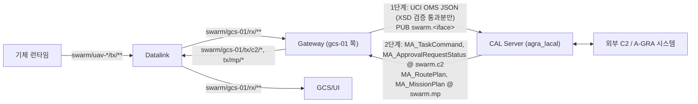

# gateway — WP9 A-GRA Gateway

시뮬레이터 내부 버스와 외부 A-GRA(UCI) 시스템 사이에서 메시지를 주고받는 지상 참여자다 (DEC-068, DEC-069, PRP-STD-002).
LA-CAL(OMS Language-Agnostic CAL)에는 서브모듈 `third_party/agra_lacal`의 CAL Client로 접속한다.



- 구독은 `swarm/<gcs>/rx/**`와 `sim/ctrl/scenario`(알려진 기체 목록, D-35)뿐이다. 발행은 `swarm/<gcs>/tx/c2/<msg>`와 `swarm/<gcs>/tx/mp/<msg>`뿐이다. 발행하는 `LinkEnvelope.publisher`에 Gateway 참여자 ID를 채운다 (DEC-077). `truth/**`, `onboard/**`, `link/**`는 쓰지 않는다.
- 버스는 `open_bus(BusConfig)`로 연다 (DEC-026).
- 매핑은 proto 옵션 `(uci_name)`, `(uci_also)`, `(mapping)`, `(l1)`을 descriptor에서 읽어 만든다. STD만 외부로 내보내고 EXT·SIM은 내보내지 않는다 (DEC-014).
- 내부 메시지 하나를 받으면 `uci_name`과 `uci_also`의 UCI 메시지를 각각 따로 변환·검증·발행한다. 하나가 실패해도 나머지는 나간다 (DEC-072).
- 변환기는 내부 메시지별 플러그인이다 (`swarm_gateway/converters/`, DEC-013). `uci_also` 대상은 UCI 메시지별 `AlsoConverter`가 맡고, 어느 내부 메시지에 쓸지는 descriptor가 정한다. 엔트리 포인트 그룹 `swarm_gateway.converters`로 둘 다 추가할 수 있다.
- XSD 검증·변환에 실패한 메시지는 보내지 않고 로그와 카운터(`Gateway.counters`, `Gateway.rejections`)에 남긴다. Gateway는 계속 동작한다.

## 준비

```bash
git submodule update --init third_party/agra_lacal
```

```bash
cd gateway && uv sync --extra zenoh
```

- 루트 워크스페이스에 아직 등록되지 않아 `gateway/`에서 독립 uv 프로젝트로 실행한다(`swarm-api`는 `../api/python` 경로 의존성). proto 생성물이 없으면 저장소 루트에서 `uv run python scripts/gen_proto.py`를 먼저 실행한다.
- 시뮬레이터와 붙이려면 `--extra zenoh`가 필요하다. 빠뜨리면 Gateway는 설치 방법을 알리고 종료 코드 1로 끝난다. 나중에 `--extra zenoh` 없이 `uv sync`를 다시 하면 Zenoh가 지워진다.
- 시험만 할 때는 `uv sync`로 충분하다. Zenoh가 없어도 시험은 통과한다(실패 종료 경로의 프로세스 시험까지 돈다).

## 시험

```bash
cd gateway && uv run pytest
```

- 시험은 InMemoryBus와 프로세스 안에서 띄운 agra_lacal CAL Server(로컬 백엔드, 포트 자동 할당)를 쓴다.

## 실행

CAL Server (agra_lacal, 이 환경에서 기동. 설정은 `config/lacal_server.yaml`):

```bash
cd gateway && uv run python -m swarm_gateway.lacal_server --config config/lacal_server.yaml
```

Gateway:

```bash
cd gateway && uv run python -m swarm_gateway --gcs gcs-01 --lacal ws://127.0.0.1:8765
```

| 옵션 | 기본값 | 내용 |
|---|---|---|
| `--gcs` | (필수) | GCS 엔티티 ID |
| `--lacal` | `ws://127.0.0.1:8765` | CAL Server OWP 주소 |
| `--participant` | `gateway-0` | 발행 참여자 ID. `LinkEnvelope.publisher`에 싣는다 (DEC-077) |
| `--service` | `swarm_gateway` | CAL Server 설정의 service_id |
| `--topic-prefix` | `swarm` | LA-CAL 토픽 `<prefix>.<iface>` (vi, c2, p2p, ms) |
| `--inbound-topic` | `<prefix>.c2` | 외부 C2 수신 토픽. MP는 `<prefix>.mp`로 고정이다 |
| `--bus` | `zenoh` | `zenoh` 또는 `memory`. `memory`는 프로세스 안 버스라 시뮬레이터 메시지가 오지 않는다. 명시했을 때만 쓰고 경고를 남긴다 |
| `--zenoh-config`, `--zenoh-mode`, `--connect`, `--listen` | | `BusConfig` 항목 |
| `--no-multicast` | 꺼짐(멀티캐스트 켬) | Zenoh 멀티캐스트 스카우팅을 끈다. 같은 PC의 다른 버스와 섞이지 않게 할 때 `--connect`와 함께 쓴다. 다른 참여자(Core·Datalink·Agent·브리지)와 같은 옵션이다 (D-27) |
| `--lacal-admin` | `--lacal` 호스트의 8766 | CAL Server 관리 주소. 새 외부 구독에 변화 보고 마지막 값을 보낸다 (DEC-089). `none`이면 끈다 |
| `--sim-epoch` | 없음(시나리오 값) | 모의 시각 0의 UTC 명시 재정의, 재현 시험용 (ISO 8601, 시간대 필수, 예 `2026-01-01T00:00:00Z`). 시나리오 값보다 우선한다 (DEC-098) |
| `--stats-s` | 10 | 카운터 로그 주기 |

외부 C2 쪽은 같은 CAL Server에 `external_c2` 서비스로 접속해 `swarm.c2` 토픽에 `MA_TaskCommand`·`MA_ApprovalRequestStatus`를, `swarm.mp` 토픽에 `MA_RoutePlan`·`MA_MissionPlan`을 PUB하면 된다.

예: 같은 PC에서 Zenoh 라우터(또는 Datalink 등)에 직접 붙고 멀티캐스트를 끈다.

```bash
cd gateway && uv run python -m swarm_gateway --gcs gcs-01 --lacal ws://127.0.0.1:8765 --no-multicast --connect tcp/127.0.0.1:7447
```

### 기동 직후 준비 전 구간 (O-13)

- Gateway는 LA-CAL에 접속(INIT)한 뒤 공개 XSD를 적재하고(수 초), 그다음에 외부 명령 구독(`SUB MA_TaskCommand swarm.c2`)을 건다.
- 접속부터 구독 완료까지는 외부 명령을 받는 쪽이 없다. 이 구간에 외부가 PUB한 `MA_TaskCommand`는 서버가 `+OK`로 답하지만 아무에게도 전달되지 않고 사라진다. 다시 보내 주지 않는다.
- 단계마다 INFO 로그를 남긴다. 외부 C2는 `ready` 줄이 나온 뒤 명령을 보내야 한다.

| 로그 | 뜻 |
|---|---|
| `gateway: LA-CAL connected ... at +N s; not ready yet` | 접속만 됐다. 아직 외부 명령을 받지 않는다 |
| `gateway: XSD loaded, mapping built at +N s` | 검증 준비 완료 |
| `gateway: LA-CAL SUB MA_TaskCommand@swarm.c2 done at +N s` | 외부 명령 구독 완료 |
| `gateway: ready at +N s: ...` | 버스 구독(`swarm/<gcs>/rx/**`)까지 끝났다. 양방향 준비 완료 |

- 외부 쪽에서는 `MA_TaskStatus`가 오지 않는 것으로만 유실을 알 수 있다. 동작 변경 제안은 TRACE.md "제안"에 적었다.

### 늦게 붙은 외부 시스템 (DEC-089)

- 변화 보고는 값이 바뀔 때만 나간다. Gateway는 내보낸 변화 보고를 키별 마지막 값으로 들고 있다가, 외부 시스템이 그 메시지를 새로 구독하면 한 번 다시 보낸다.
- 대상: `SystemStatus`, `MA_FlightCapability`, `PO_Activity`·`EA_Activity`(장비별), `StrikeActivity`(무장별), `StoreLoadoutConfiguration`, `MA_TaskStatus`(작업별). 종료 상태가 된 작업·무장은 지운다. `MA_FlightCommandStatus`는 다시 보내지 않는다(명령 상태 규칙, DEC-097).
- 주기 보고(`MA_NavigationReport`, `MA_PositionReport`, `MA_PackagePartnerStatusReport`)와 `MA_ApprovalRequest`, `MA_LeaderUpdateRequest`, `MA_Entity`는 다시 보내지 않는다.
- 구독 시점은 CAL Server 관리 포트의 그래프 이벤트(`/graph/events`)로 안다. OWP에는 구독 알림이 없기 때문이다. 관리 포트에 붙지 못하면 경고를 남기고 2 s마다 다시 시도한다. 나머지 동작은 그대로다.
- 다시 보낸 값은 같은 토픽의 기존 구독자에게도 한 번 더 간다. Gateway가 재기동하면 보관 값이 없다.
- 외부 상태 표현은 공개 XSD enum 그대로다 (DEC-090). `MA_FlightCommandStatus`에는 EXECUTING·COMPLETED가 없어 ACCEPTED로 보이므로 수행·완료는 `MA_TaskStatus`에서 읽는다.

### 명령 상태 (DEC-097)

- `MessageData`에 `CommandID`와 `CommandProcessingState`가 있는 메시지(지금은 `MA_FlightCommandStatus`)는 UCI Command-2 상태 기계를 따른다. ACCEPTED·REJECTED·CANCELED가 끝 상태다.
- 한 (보고 기체, CommandID)에 끝 상태를 한 번 내면 그 ID의 상태는 더 내지 않는다. 내부의 이후 EXECUTING·COMPLETED·CANCELLED·FAILED와 같은 끝 상태 반복도 내지 않는다(카운터 `skipped_command_state`). RECEIVED 반복도 내지 않는다.
- 첫 보고는 무엇이든 낸다. 접수 전에 대체된 명령의 첫 CANCELED, 처음 본 보고가 EXECUTING인 명령의 ACCEPTED가 그렇다.
- 늦게 붙은 외부 시스템에 다시 보내지 않는다. 다시 보낸 값은 기존 구독자에게도 가서 같은 ID의 두 번째 보고가 되기 때문이다.
- Gateway가 재기동하면 끝난 ID를 기억하지 못한다. 재기동 뒤 처음 보는 ID의 보고는 첫 보고로 보고 한 번 낸다. 그래서 재기동 앞뒤로 같은 끝 상태가 ID당 최대 한 번 더 나갈 수 있다. 그 뒤는 다시 막는다. 외부는 재기동 전 끝 상태를 받은 ID의 다음 보고를 무시하면 된다.
- 수행 상태(`MA_FlightActivity`)는 내지 않는다.

### UCI 시각 (D-36, DEC-098)

- UCI 머리 `Timestamp`와 위치·속도·자세 시각은 벽시계가 아니라 메시지 모의 시각(`header.sim_time_us`)의 UTC다. `MA_Entity`의 운동·식별 시각은 관측 모의 시각(`observed_time_us`)이다.
- UTC = 기준 시각 + 모의 시각 (계약 §1). 기준 시각의 우선순위:
  1. `--sim-epoch` (명시 재정의, 재현 시험용). 시나리오 값이 와도 바꾸지 않는다(로그만).
  2. `sim/ctrl/scenario`의 `Scenario.run.epoch_utc_us` (0이 아닐 때). Core가 적재 때 채워 알리므로 보통 이 값이다.
  3. 시나리오를 받기 전에 온 첫 메시지: 그때 벽시계 − 그 모의 시각. 경고 로그 `no scenario epoch yet`를 남긴다.
- 3으로 정한 뒤 시나리오 값이 오면 **시나리오 값으로 바꾼다**. 다른 참여자(Logger·UI 등)와 같은 기준을 써야 하고, 시나리오 값이 실행 전체의 기준이기 때문이다. 바꾼 차이는 경고 로그 `UCI time base changed ... shift ±N s`와 카운터 `epoch_changed`에 남는다.
- 새 시나리오를 적재해 다른 값이 오면 그 값으로 다시 정한다(`epoch_changed`). 같은 값의 재발행과 값 0은 기준을 바꾸지 않는다.
- C3 기준((Timestamp − 모의 시각)이 한 실행 안에서 일정)과의 관계: 한 기준 안에서는 일시정지·배속에서도 차이가 일정하다. 차이가 바뀌는 곳은 (a) 시나리오를 받기 전 첫 메시지 기준으로 낸 보고에서 시나리오 기준으로 넘어갈 때 한 번, (b) 새 시나리오 적재(새 실행)뿐이다. (a)는 Gateway가 Core보다 늦게 켜져도 `sim/ctrl/scenario`를 곧 받으므로(늦게 붙는 참여자 포함) 보통 일어나지 않는다. 일어나면 로그·카운터로 그 시점이 보인다.

### 알려진 기체 (D-35)

- 외부 `MA_TaskCommand`·`MA_RoutePlan`·`MA_MissionPlan`이 가리키는 기체는 모두 알려진 기체여야 한다. 하나라도 모르면 버스에 내지 않고 거부로 기록한다(`Gateway.rejections`, 카운터 `ext_rejected`).
- 알려진 기체 = `sim/ctrl/scenario`의 `ENTITY_KIND_UAV` 엔티티 + 이 GCS rx로 보고를 보낸 엔티티. truth는 읽지 않는다. 시나리오가 바뀌면 둘 다 새로 시작한다.
- 작업 ID가 있는 명령(`MA_TaskCommand`, `MA_MissionPlan`)을 거부하면 모르는 기체별로 `MA_TaskStatus`(`ExecutionState` = `DROPPED`, 사유 포함)를 `swarm.c2`로 내 외부에 알린다. `MA_RoutePlan`은 알릴 상태 메시지가 없어 거부 기록만 남는다.

## 교환 메시지

| 방향 | 내부 메시지 (rx/tx 키) | UCI 메시지 | LA-CAL 토픽 |
|---|---|---|---|
| 발행 | `NavigationReport` | `MA_NavigationReport` | `swarm.vi` |
| 발행 | `NavigationReport` (uci_also) | `MA_PositionReport` | `swarm.vi` |
| 발행 | `SystemStatus` | `SystemStatus` | `swarm.vi` |
| 발행 | `FlightCommandStatus` | `MA_FlightCommandStatus` | `swarm.vi` |
| 발행 | `FlightCapability` | `MA_FlightCapability` | `swarm.vi` |
| 발행 | `TaskStatus` | `MA_TaskStatus` | `swarm.c2` |
| 발행 | `ApprovalRequest` | `MA_ApprovalRequest` | `swarm.c2` |
| 발행 | `PeerStatus` | `MA_PackagePartnerStatusReport` | `swarm.p2p` |
| 발행 | `PeerStatus` (uci_also) | `MA_PositionReport` | `swarm.p2p` |
| 발행 | `LeaderUpdate` | `MA_LeaderUpdateRequest` | `swarm.p2p` |
| 발행 | `TrackShare` | `MA_Entity` | `swarm.p2p` |
| 발행 | `SensorActivity` | `PO_Activity` | `swarm.ms` |
| 발행 | `JammerActivity` | `EA_Activity` | `swarm.ms` |
| 발행 | `StrikeActivity` | `StrikeActivity` | `swarm.ms` |
| 발행 | `StoreLoadout` | `StoreLoadoutConfiguration` | `swarm.ms` |
| 수신 | `TaskCommand` → `swarm/<gcs>/tx/c2/TaskCommand` | `MA_TaskCommand` | `swarm.c2` |
| 수신 | `ApprovalResponse` → `swarm/<gcs>/tx/c2/ApprovalResponse` | `MA_ApprovalRequestStatus` | `swarm.c2` |
| 수신 | `RoutePlan` → `swarm/<gcs>/tx/mp/RoutePlan` | `MA_RoutePlan` | `swarm.mp` |
| 수신 | `MissionPlan` → `swarm/<gcs>/tx/mp/MissionPlan` | `MA_MissionPlan` | `swarm.mp` |

### ID 변환

- 내부 문자열 ID(엔티티·작업·명령)는 고정 이름공간의 UUIDv5로 바꾸고 `DescriptiveLabel`에 원래 ID를 싣는다.
- 받은 ID는 `DescriptiveLabel`을 먼저 쓰고, 없으면 Gateway가 만든 UUID의 역표를 쓴다.

### 외부 승인 응답 (DEC-075)

- `RequestProcessingState`가 `COMPLETED`이고 `ApprovalRequestProcessingState`가 `APPROVED` 또는 `REJECTED`인 것만 받는다. `PENDING`, `CANCELED`, 처리 중인 상태는 `approved`(참/거짓)로 표현할 수 없어 거부한다.
- Gateway가 그 요청을 내보냈으면 요청한 기체로만 보낸다. 모르는 요청(재기동 뒤 포함)은 `dst`를 비워 보내고, 받는 쪽이 `request_id`로 가른다.

### 임무 계획 수신 (DEC-076)

공개 XSD에서 `MA_RoutePlan`은 위치를 직접 담지만, `MA_MissionPlan`은 하위 계획을 ID로 참조만 한다. 대상은 `Applicability/ApplicableToIDs`다.

| 항목 | 지원 | 거부 (XSD를 통과해도 거부·기록) |
|---|---|---|
| 대상 (`dst`, `entity_id`, `assignees`) | `ApplicableToIDs/SystemID` 하나. Label이 엔티티 ID이거나 Gateway가 만든 UUID | `ALL`, `NON`, `PackageID` |
| 계획 상태 | `ForPlanningUseOnly` = false | true (XSD 주석: 기능을 일으키면 안 된다) |
| 시간 | 없음 | `Window`, 세그먼트 `RequiredTimeOfArrival` |
| 경로 구성 | `PRIMARY` 경로 하나. `FirstInPathSegmentID`와 `NextPathSegment`로 끝까지 이어진 세그먼트 | 여러 경로, 다른 `PathType`·`RouteType`, 끊김, 순환, 조건부 세그먼트 |
| 항로점 | `WayPoint`, `NAV_ONLY`, 절대 좌표 `Point2D`, `Altitude`와 `AltitudeReference`=`MSL` | `TurnPoint`, `LoiterPoint`, 상대 좌표, 고도 범위, 다른 고도 기준 |
| 속력 | `SpeedValue`(`GROUNDSPEED`, `TRUE_AIRSPEED`) | `CALIBRATED_AIRSPEED`, Mach, 최적화 지시 |
| 구간 종류 | 없음, `TF`, `DF`, `IF` | 그 밖의 `CivilPathTerminator`, `Climb`, `MaximumRoll`, `Acceleration` 등 |
| `MA_MissionPlan` 하위 계획 | 먼저 받은 `RoutePlanID`만, 대상이 같을 때 | `TaskPlanID` 등 다른 하위 계획, 받지 못한 경로, 판(`Version`) 불일치, 빈 계획, `ExecutionSequence`, 상하위 계획 참조 |

- `MA_RoutePlan` → `RoutePlan`(항로점별 위치·속력). 수락 반경은 XSD에 없어 비워 두고 FA 기본값을 쓴다.
- `MA_MissionPlan`은 참조한 경로마다 작업 하나로 편다. 항로점 하나면 `move_to`, 둘 이상이면 `route`이고 `task_id`는 경로 ID다.
- 외부는 `MA_RoutePlan`을 먼저 보낸 뒤 `MA_MissionPlan`을 보낸다. 받은 경로는 프로세스 메모리에만 있어(최근 1024건) 재기동 뒤에는 다시 보내야 한다.
- 영역 탐색(`search_area`) 등 경로로 표현되지 않는 작업은 받지 못한다(CR-GW-007).
- 내장 MA는 `MissionPlan`을 시작할 때만 읽는다. 실행 중에 받은 계획을 바로 수행하는 경로는 `waypoint` MA의 `RoutePlan`뿐이다(CR-GW-008).

### 외부 `MA_TaskCommand` 규칙 (DEC-076으로 유지)

- `Command` 항목 하나가 수행 기체 하나다. `CapabilityID.DescriptiveLabel` = `<엔티티 ID>/<작업 종류>`.
- 작업 종류는 위치 정보가 필요 없는 `hold`(현재 위치 선회 대기)와 `return_to_base`만 받는다.
- 위치가 필요한 작업은 임무 계획 경로로 받는다. 이 규칙은 hold, return_to_base, 취소에만 쓴다.
- `TaskID.DescriptiveLabel` = 내부 `task_id`. `CommandState`가 `CANCEL`이면 취소 명령이다.
- 모든 항목은 같은 `TaskID`와 `CommandState`를 가져야 한다. 어긋나면 거부한다.

## 구성

| 경로 | 내용 |
|---|---|
| `src/swarm_gateway/lacal.py` | 서브모듈 경로, OMS JSON 코덱(XSD 검증), CAL Client |
| `src/swarm_gateway/mapping.py` | descriptor 기반 매핑 표 |
| `src/swarm_gateway/ids.py` | 문자열 ID ⇄ UUID |
| `src/swarm_gateway/converters/` | 메시지별 변환기 (vi, c2, p2p, ms, mp)와 uci_also 대상 변환기 (position: `MA_PositionReport`) |
| `src/swarm_gateway/gateway.py` | 1단계·2단계 처리, 카운터, 거부 기록 |
| `src/swarm_gateway/runner.py` | LA-CAL 접속 (PUB/SUB 연결) |
| `src/swarm_gateway/command_state.py` | 외부 명령 상태 상태 기계 (DEC-097) |
| `src/swarm_gateway/entities.py` | 알려진 기체 목록 (시나리오·수신 보고, D-35) |
| `src/swarm_gateway/retain.py` | 변화 보고 마지막 값 보관, 늦게 붙은 구독자 전달 (DEC-089) |
| `src/swarm_gateway/__main__.py` | 진입점 |
| `src/swarm_gateway/lacal_server.py` | agra_lacal CAL Server 기동 래퍼 |
| `config/lacal_server.yaml` | 시험·연동용 CAL Server 설정 (서비스 `swarm_gateway`, `external_c2`. `external_c2`는 교환 표의 발행 15개 흐름을 모두 구독으로 선언한다, D-39) |
