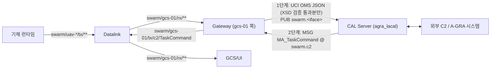

# gateway — WP9 A-GRA Gateway

시뮬레이터 내부 버스와 외부 A-GRA(UCI) 시스템 사이에서 메시지를 주고받는 지상 참여자다 (DEC-068, DEC-069, PRP-STD-002).
LA-CAL(OMS Language-Agnostic CAL)에는 서브모듈 `third_party/agra_lacal`의 CAL Client로 접속한다.



- 구독은 `swarm/<gcs>/rx/**` 하나뿐이다. 발행은 `swarm/<gcs>/tx/c2/<msg>`뿐이다. `truth/**`, `onboard/**`, `link/**`는 쓰지 않는다.
- 버스는 `open_bus(BusConfig)`로 연다 (DEC-026).
- 매핑은 proto 옵션 `(uci_name)`, `(mapping)`, `(l1)`을 descriptor에서 읽어 만든다. STD만 외부로 내보내고 EXT·SIM은 내보내지 않는다 (DEC-014).
- 변환기는 내부 메시지별 플러그인이다 (`swarm_gateway/converters/`, DEC-013). 엔트리 포인트 그룹 `swarm_gateway.converters`로 추가할 수 있다.
- XSD 검증·변환에 실패한 메시지는 보내지 않고 로그와 카운터(`Gateway.counters`, `Gateway.rejections`)에 남긴다. Gateway는 계속 동작한다.

## 준비

```bash
git submodule update --init third_party/agra_lacal
```

```bash
cd gateway && uv sync
```

- 루트 워크스페이스에 아직 등록되지 않아 `gateway/`에서 독립 uv 프로젝트로 실행한다(`swarm-api`는 `../api/python` 경로 의존성). proto 생성물이 없으면 저장소 루트에서 `uv run python scripts/gen_proto.py`를 먼저 실행한다.
- Zenoh 버스를 쓰려면 `uv sync --extra zenoh`.

## 시험

```bash
cd gateway && uv run pytest
```

- 시험은 InMemoryBus와 프로세스 안에서 띄운 agra_lacal CAL Server(로컬 백엔드, 포트 자동 할당)를 쓴다.

## 실행

CAL Server (agra_lacal, 이 환경에서 기동. 설정은 `config/lacal_server.yaml`):

```bash
cd gateway && uv run python -m swarm_gateway.lacal_server --config config/lacal_server.yaml
```

Gateway:

```bash
cd gateway && uv run python -m swarm_gateway --gcs gcs-01 --lacal ws://127.0.0.1:8765
```

| 옵션 | 기본값 | 내용 |
|---|---|---|
| `--gcs` | (필수) | GCS 엔티티 ID |
| `--lacal` | `ws://127.0.0.1:8765` | CAL Server OWP 주소 |
| `--service` | `swarm_gateway` | CAL Server 설정의 service_id |
| `--topic-prefix` | `swarm` | LA-CAL 토픽 `<prefix>.<iface>` (vi, c2, p2p, ms) |
| `--inbound-topic` | `<prefix>.c2` | 외부 C2 수신 토픽 |
| `--bus`, `--zenoh-config`, `--zenoh-mode`, `--connect`, `--listen` | | `BusConfig` 항목 |
| `--stats-s` | 10 | 카운터 로그 주기 |

외부 C2 쪽은 같은 CAL Server에 `external_c2` 서비스로 접속해 `swarm.c2` 토픽에 `MA_TaskCommand`를 PUB하면 된다.

## 교환 메시지

| 방향 | 내부 메시지 (rx/tx 키) | UCI 메시지 | LA-CAL 토픽 |
|---|---|---|---|
| 발행 | `NavigationReport` | `MA_NavigationReport` | `swarm.vi` |
| 발행 | `SystemStatus` | `SystemStatus` | `swarm.vi` |
| 발행 | `FlightCommandStatus` | `MA_FlightCommandStatus` | `swarm.vi` |
| 발행 | `FlightCapability` | `MA_FlightCapability` | `swarm.vi` |
| 발행 | `TaskStatus` | `MA_TaskStatus` | `swarm.c2` |
| 발행 | `ApprovalRequest` | `MA_ApprovalRequest` | `swarm.c2` |
| 발행 | `PeerStatus` | `MA_PackagePartnerStatusReport` | `swarm.p2p` |
| 발행 | `LeaderUpdate` | `MA_LeaderUpdateRequest` | `swarm.p2p` |
| 발행 | `TrackShare` | `MA_Entity` | `swarm.p2p` |
| 발행 | `SensorActivity` | `PO_Activity` | `swarm.ms` |
| 발행 | `JammerActivity` | `EA_Activity` | `swarm.ms` |
| 발행 | `StrikeActivity` | `StrikeActivity` | `swarm.ms` |
| 발행 | `StoreLoadout` | `StoreLoadoutConfiguration` | `swarm.ms` |
| 수신 | `TaskCommand` → `swarm/<gcs>/tx/c2/TaskCommand` | `MA_TaskCommand` | `swarm.c2` |

### ID 변환

- 내부 문자열 ID(엔티티·작업·명령)는 고정 이름공간의 UUIDv5로 바꾸고 `DescriptiveLabel`에 원래 ID를 싣는다.
- 받은 ID는 `DescriptiveLabel`을 먼저 쓰고, 없으면 Gateway가 만든 UUID의 역표를 쓴다.

### 외부 `MA_TaskCommand` 규칙 (임시, CR-GW-003)

- `Command` 항목 하나가 수행 기체 하나다. `CapabilityID.DescriptiveLabel` = `<엔티티 ID>/<작업 종류>`.
- 작업 종류는 위치 정보가 필요 없는 `hold`(현재 위치 선회 대기)와 `return_to_base`만 받는다.
- `TaskID.DescriptiveLabel` = 내부 `task_id`. `CommandState`가 `CANCEL`이면 취소 명령이다.
- 모든 항목은 같은 `TaskID`와 `CommandState`를 가져야 한다. 어긋나면 거부한다.

## 구성

| 경로 | 내용 |
|---|---|
| `src/swarm_gateway/lacal.py` | 서브모듈 경로, OMS JSON 코덱(XSD 검증), CAL Client |
| `src/swarm_gateway/mapping.py` | descriptor 기반 매핑 표 |
| `src/swarm_gateway/ids.py` | 문자열 ID ⇄ UUID |
| `src/swarm_gateway/converters/` | 메시지별 변환기 (vi, c2, p2p, ms) |
| `src/swarm_gateway/gateway.py` | 1단계·2단계 처리, 카운터, 거부 기록 |
| `src/swarm_gateway/runner.py` | LA-CAL 접속 (PUB/SUB 연결) |
| `src/swarm_gateway/__main__.py` | 진입점 |
| `src/swarm_gateway/lacal_server.py` | agra_lacal CAL Server 기동 래퍼 |
| `config/lacal_server.yaml` | 시험·연동용 CAL Server 설정 (서비스 `swarm_gateway`, `external_c2`) |
