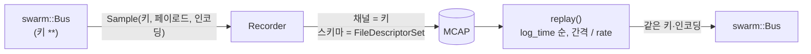

# WP7 기록·재생 (LOG) 추적표

## 구조

## 구현

| ID | 내용 | 위치 | 근거 |
|---|---|---|---|
| IMP-LOG-001 | `Recorder`: 버스의 키 표현식(기본 `**`)을 구독해 MCAP으로 기록. 채널은 (키, 인코딩)마다 하나, topic = Zenoh 키, 원래 인코딩은 채널 메타데이터 `zenoh_encoding`. 다중 스레드 콜백 안전 | `src/mcap_log.cpp`, `include/swarm/logger/mcap_log.hpp` | DEC-011, PRP-LOG-001, REQ-LOG-001 |
| IMP-LOG-002 | 스키마: `application/protobuf;<타입>`이면 schema encoding `protobuf`, 데이터는 의존 파일을 먼저 둔 FileDescriptorSet. 모르는 타입·비 protobuf는 스키마 없이 기록. 정적 라이브러리에서 swarm.v1 디스크립터 등록 보장 | `src/mcap_log.cpp` | DEC-011, PRP-LOG-001 |
| IMP-LOG-003 | `replay()`: log_time 순으로 읽어 원래 간격 / rate로 같은 키·인코딩에 발행. rate ≤ 0은 최대 속도, 키 필터, `std::stop_token` 정지, 시계·대기 주입 | `src/mcap_log.cpp` | REQ-LOG-001, DEC-011 |
| IMP-LOG-004 | `inspect()`: 채널별 메시지 수·인코딩·스키마, 시간 범위 | `src/mcap_log.cpp` | REQ-LOG-001 |
| IMP-LOG-005 | 실행 파일 `swarm_logger info / record / replay [--rate] [--key] [--backend] [--dry-run]`. 버스 백엔드는 현재 `memory`만 있다(Zenoh는 통합 시 연결) | `src/main.cpp` | REQ-LOG-001, REQ-NET-001 |
| IMP-LOG-006 | 의존성: vcpkg `mcap`(`unofficial-mcap`, 헤더 전용, 압축 없음). 없으면 `MCAP_INCLUDE_DIR`에서 헤더를 찾고, 둘 다 없으면 logger/를 건너뛴다 | `CMakeLists.txt`, 루트 `vcpkg.json` | DEC-022 |
| IMP-LOG-007 | `swarm_logger`의 버스를 공용 `open_bus`로 연다. Zenoh 백엔드와 공통 버스 옵션(`--bus`, `--connect` 등) 지원 | `src/main.cpp`, `CMakeLists.txt` | DEC-026 |
| IMP-LOG-008 | 재생 시 `sim/ctrl/status`의 `SimStatus.replay`를 true로 바꿔 발행 | `src/mcap_log.cpp` | DEC-031 |
| IMP-LOG-009 | `swarm_logger record`가 SIGTERM과 Windows Ctrl+Break(SIGBREAK)도 처리해 MCAP을 닫고 종료 (P0 데모 실행기에서 프로그램으로 정지) | `src/main.cpp` | REQ-LOG-001, DEC-026 |
| IMP-LOG-010 | 기록기 유한 큐: 구독 콜백은 큐에 넣기만 하고 쓰기 스레드가 MCAP에 쓴다. 건수(100,000)·바이트(64 MiB) 상한을 넘으면 새 샘플을 버리고 `dropped_count()`에 센다. `stats()`로 큐 길이·최대치·드롭 수를 본다. CLI `--stats`, `--max-queue-messages`, `--max-queue-mib` (QA-006) | `src/mcap_log.cpp`, `include/swarm/logger/mcap_log.hpp`, `src/main.cpp` | REQ-LOG-001, DEC-011 |
| IMP-LOG-011 | 메시지 색인을 쓰지 않는다(`RecorderOptions::message_index`=false). 채널이 수만 개일 때 writer의 청크별 색인이 RSS를 부하에 비례해 키웠다(QA-006 원인). 색인이 없으므로 log_time을 단조 증가로 고정하고, 읽을 때 색인이 없는 파일은 파일 순서로 읽는다 | `src/mcap_log.cpp` | REQ-LOG-001, DEC-011 |

## 시험

`ctest --preset msvc-debug` (시험 `swarm_logger_tests`)

| ID | 내용 | 위치 | 근거 | 결과 |
|---|---|---|---|---|
| TC-LOG-001 | 채널 topic = 키, message encoding `protobuf`, 스키마 이름·인코딩, 메타데이터 인코딩. 스키마의 FileDescriptorSet만으로 풀을 만들어 TruthFrame을 동적 해석하면 원본과 같다. 비 protobuf·모르는 타입은 스키마 0 | `tests/test_logger.cpp` | IMP-LOG-001, IMP-LOG-002 | Pass |
| TC-LOG-002 | InMemoryBus 기록 → 재생: (키, 페이로드, 인코딩) 순서열 일치, 시간 범위, inspect 합계 | `tests/test_logger.cpp` | IMP-LOG-001, IMP-LOG-003, IMP-LOG-004 | Pass |
| TC-LOG-003 | 배속 1, 2, 0.5에서 발행 시각 오프셋 = 기록 오프셋 / rate (가짜 시계). rate 0은 대기 없음 | `tests/test_logger.cpp` | IMP-LOG-003 | Pass |
| TC-LOG-004 | 재생 키 필터(`swarm/*/tx/**`)와 기록 키 필터(`truth/**`) | `tests/test_logger.cpp` | IMP-LOG-001, IMP-LOG-003 | Pass |
| TC-LOG-005 | `stop_token`으로 재생 중단 | `tests/test_logger.cpp` | IMP-LOG-003 | Pass |
| TC-LOG-006 | 4개 스레드 동시 발행 2000건을 모두 기록 | `tests/test_logger.cpp` | IMP-LOG-001 | Pass |
| TC-LOG-007 | 재생한 `SimStatus`의 `replay`=true, 나머지 필드 보존 | `tests/test_logger.cpp` | IMP-LOG-008 | Pass |
| TC-LOG-008 | 큐 상한: 상한 0이면 전부 드롭, 상한 8이면 큐 최대 ≤8, 쓴 수+드롭 수=보낸 수 | `tests/test_logger.cpp` | IMP-LOG-010 | Pass |
| TC-LOG-009 | 150만 건·채널 1.5만 개 기록 시 RSS 증가 <100 MB(실측 41 MB), 드롭 0 | `tests/test_logger.cpp` | IMP-LOG-011 | Pass |
| TC-LOG-010 | 시계가 거꾸로 가도 파일이 log_time 순이고 재생 순서가 맞다(색인 유/무) | `tests/test_logger.cpp` | IMP-LOG-011 | Pass |

시험 결과(2026-11-01, msvc-debug): swarm_api_tests, swarm_logger_tests 통과 (100% tests passed out of 2)
시험 결과(2026-11-03, msvc-debug): swarm_logger_tests 통과 (TC-LOG-008~010 추가). QA-006: 큐 대기가 아니라 MCAP 메시지 색인이 원인이어서 IMP-LOG-011로 고쳤다.
