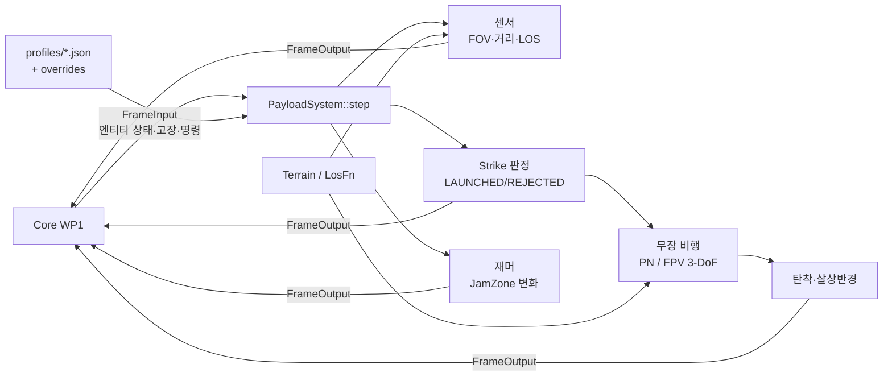

# WP8 Payload 추적표

모듈 코드 PAY. 근거: DEC-046(P5 착수, 순수 계산기), DEC-047(SENSOR 고장), DEC-009, DEC-012, DEC-018, DEC-019, PRP-DYN-003, PRP-PAY-001.

## 구조

## 구현 (IMP)

| ID | 내용 | 위치 | 근거 | 시험 |
|---|---|---|---|---|
| IMP-PAY-001 | 측지 NED 변환, FRD→NED, 방위·고각, DEM 가시선(곡률 처짐, 끝점 허용오차) | `include/swarm/payload/geometry.hpp`, `src/geometry.cpp` | DEC-004, DEC-018 | TC-PAY-001~003 |
| IMP-PAY-002 | 형식별 프로파일 JSON, 기본 프로파일, `PayloadSpec.overrides` 재정의(키 순), 빌드 시 내장 | `include/swarm/payload/profiles.hpp`, `src/profiles.cpp`, `profiles/*.json`, `CMakeLists.txt` | DEC-019, REQ-PAY-001, REQ-PAY-005 | TC-PAY-002, 009, 013 |
| IMP-PAY-003 | 카메라 탐지(FOV·거리·LOS, 확률 없음), 지향(az/el·geo·track), SENSOR 고장 시 탐지 없음·active=false | `src/payload_system.cpp` | DEC-018, DEC-047, REQ-PAY-002 | TC-PAY-001~004 |
| IMP-PAY-004 | 재머·jammer_site 재밍 구역. 켬/끔·반경·이동(update_distance_m) 변화 때만 JamZone 이벤트, owner=엔티티 ID | `src/payload_system.cpp` | DEC-009, DEC-028, DEC-030, REQ-PAY-003 | TC-PAY-005 |
| IMP-PAY-005 | 무장 비행: aam/agm 질점+PN(추력·항력·G 한계·탐색기 FOV), fpv 3-DoF+선행 추적, 근접 신관, 지면 교차 이분법 보정, 비행 시간 초과 | `include/swarm/payload/weapon.hpp`, `src/weapon.cpp` | PRP-DYN-003, DEC-005, DEC-012 | TC-PAY-008~011, 014 |
| IMP-PAY-006 | Strike 판정(잔량·락온·거리·LOS), `wpn-<shooter>-<seq>` ID, 잔량·StoreLoadout, 살상반경 다중 파괴, Launch/Spawn/Impact/Kill 이벤트 | `src/payload_system.cpp` | DEC-012, DEC-019, REQ-PAY-004, REQ-PAY-005 | TC-PAY-006~011, 013 |
| IMP-PAY-007 | 프레임 계산기: 벽시계·난수 없음, 엔티티 ID 순 처리, 이벤트 시각 순 정렬, reset | `include/swarm/payload/payload.hpp`, `src/payload_system.cpp` | DEC-046, PRP-PAY-001, REQ-SIM-001 | TC-PAY-012 |

## 시험 (TC)

ctest 이름 `pay.TC-PAY-NNN`, 실행 파일 `swarm_payload_tests`. msvc-debug 2026-11-05 전체 14건 통과.

| ID | 내용 | 근거 | 결과 |
|---|---|---|---|
| TC-PAY-001 | FOV 경계: 수평 ±29.8° 탐지/±30.2° 미탐지, 수직 19.8°/20.2°, 후방 미탐지, 기체 방위 회전 | DEC-018 | 통과 |
| TC-PAY-002 | 거리: 2990 m 탐지/3010 m 미탐지, 재정의 4000 m | DEC-018, DEC-019 | 통과 |
| TC-PAY-003 | 가시선: 능선 DEM 차폐, 능선 앞 표적 탐지, 지면 위 표적 탐지 | DEC-018 | 통과 |
| TC-PAY-004 | SENSOR 고장: 탐지 없음·active=false, 해제 후 복귀, 명령으로 끈 센서 | DEC-047 | 통과 |
| TC-PAY-005 | 재밍 구역: site 처음 켬, 변화 없으면 이벤트 없음, 켬/끔, 이동 30 m 무시·80 m 갱신, 반경 상한, site 파괴 시 끔 | DEC-009 | 통과 |
| TC-PAY-006 | 잔량 0 거부(no_stores), 무장 ID, Launch·Spawn, StoreLoadout, unknown_station, reset | DEC-012, DEC-019 | 통과 |
| TC-PAY-007 | 락온 실패: 후방, 탐색기 FOV 밖, DEM 차폐 / out_of_range / aam 좌표 사격 no_target | DEC-012 | 통과 |
| TC-PAY-008 | PN 명중: 횡단 공중 표적 근접 신관, Impact·Kill 1건, 무장 최종 상태 alive=false | PRP-DYN-003 | 통과 |
| TC-PAY-009 | PN 빗나감: max_g 0.5, 비행 시간 6 s → MISSED(expired), 파괴 없음 | PRP-DYN-003, DEC-019 | 통과 |
| TC-PAY-010 | 지면 탄착: 지형 고도 50 m, 탄착 고도 오차 ≤ 1 mm, 탄착 시각이 프레임 안 | DEC-005, DEC-012 | 통과 |
| TC-PAY-011 | 살상반경 15 m 안 3개 파괴(ID 순), 밖 1개 생존, 재파괴 없음 | DEC-012 | 통과 |
| TC-PAY-012 | 같은 입력 2회(별개 인스턴스, reset 후) 출력 바이트 동일 | DEC-046, REQ-SIM-001 | 통과 |
| TC-PAY-013 | 내장 프로파일, 재정의, 오류(모르는 키·형식·프로파일, 문자열 값, 재머 2개, 중복 ID), 무장 ID 충돌 건너뜀 | DEC-019 | 통과 |
| TC-PAY-014 | FPV 종말 유도: 이동 지상 표적 명중·파괴 | PRP-DYN-003 | 통과 |

## 결정과 근거 (WP8 내부)

- 무장 종료는 `FrameOutput.weapons`에 alive=false 상태를 한 번 더 내는 것으로 알린다. 무장 자신에 대한 KillEvent는 내지 않는다 (KillEvent.cause에 소진·만료 값이 없다).
- JamZoneEvent.owner = 엔티티 ID. Datalink가 owner로 구역을 키잉하므로 엔티티당 재머 하나만 받는다.
- 움직이는 재머는 중심 이동이 `update_distance_m`를 넘을 때만 갱신 이벤트를 낸다.
- 비행 중 탐색기는 FOV만 판정하고 LOS는 판정하지 않는다. FOV를 한 번 벗어나면 유도를 멈춘다.
- 표적이 파괴·소실되면 마지막 위치로 좌표 유도한다.
- 무장 ID 순번은 2자리(`%02u`)이며, 시나리오 엔티티 ID와 겹치면 건너뛴다.
