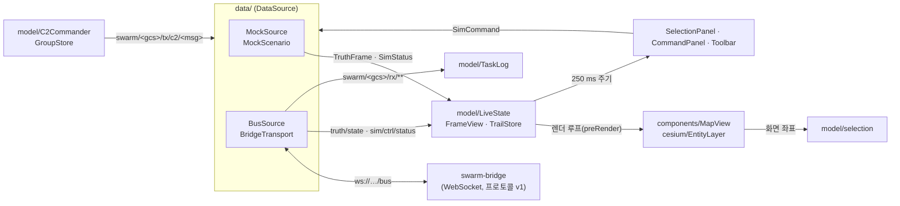

# WP5 GCS/UI (`ui/`)

TypeScript + React + CesiumJS(Vite). 모듈 코드 `UI`. `ui/monitor/`는 WP6 영역이다.

## 명령

```bash
npm install
```

```bash
npm run dev
```

```bash
npm run build
```

```bash
npm test
```

- `npm run gen:proto`: `../proto/swarm/v1` → `src/gen/` (protobuf-es). `dev`·`build`·`test` 앞에 자동으로 실행된다. `src/gen/`은 커밋하지 않는다.
- 데이터 소스 선택: 도구 막대의 소스 목록 또는 쿼리 `?source=mock`(기본) / `?source=bus`.
  - 버스 소스는 WebSocket 브리지(`bridge/`, DEC-027)로 붙는다. `?bridge=ws://host:8765/bus`(기본 `ws://<페이지 호스트>:8765/bus`, 환경변수 `VITE_BRIDGE_URL`)
  - `?gcs=gcs-01`(기본, 환경변수 `VITE_GCS`): 이 UI가 맡은 GCS. 비우면 관찰만 하고 C2 명령을 보내지 않는다.

## 구조



- `model/`은 Cesium에 의존하지 않는다. 단위 시험은 이 계층과 `data/`를 대상으로 한다.
- 프레임마다 React를 다시 그리지 않는다. 지도는 Cesium 렌더 루프에서 `LiveState`를 읽고, 패널은 250 ms마다 다시 그린다.
- 엔티티는 Cesium Entity API 대신 Billboard·Polyline·Label 프리미티브로 직접 관리한다(엔티티 수 증가 대비).

## 오프라인 지도 (DEC-003, DEC-004, DEC-016)

- Cesium ion 등 외부 서비스에 접속하지 않는다. geocoder·base layer picker를 끈다.
- dev·preview 서버는 저장소 루트 `data/`를 `/data/`로 제공한다. 위치는 `SWARM_DATA_DIR`로 바꿀 수 있다.

| 데이터 | 기본 경로 | 판정 | 없을 때 |
|---|---|---|---|
| 영상 타일(TMS) | `data/tiles/imagery/` | `tilemapresource.xml` 존재 | Cesium 내장 Natural Earth II(저해상도) |
| 지형(quantized-mesh) | `data/tiles/terrain/` | `layer.json` 존재 | 기본 타원체 |

- 환경변수 `VITE_IMAGERY_URL`(TMS 디렉터리 또는 `{z}/{x}/{y}` 템플릿), `VITE_TERRAIN_URL`로 경로를 바꾼다.
- gzip으로 저장된 `.terrain` 파일은 `Content-Encoding: gzip`으로 제공한다(cesium-terrain-builder 산출물).

## 입력 (REQ-UI-002, PRP-UI-001)

| 입력 | 동작 |
|---|---|
| 왼쪽 클릭 | 가장 가까운 엔티티 선택(14 px 이내). 빈 곳은 선택 해제 |
| 왼쪽 드래그 | 박스 선택. 박스 안에 청군 UAV/FPV가 있으면 그것만 고른다 |
| Shift / Ctrl + 선택 | 추가 / 토글 |
| Ctrl+A, Esc | 청군 UAV/FPV 전체 선택, 선택·추종 해제 |
| 오른쪽 드래그, 휠 | 카메라 이동(3D 회전), 확대 |
| 가운데 드래그, Ctrl+오른쪽 드래그 | 기울이기 |
| 오른쪽 클릭(끌지 않음) | 선택한 아군 비행체에 MoveTo (고도는 대상 평균 고도) |
| H, 명령 패널 | Hold. 명령 패널에서 RTB, 편대(모양·간격, 첫 선택 기체가 리더) |
| Ctrl+숫자 또는 Alt+숫자 | 선택을 부대 그룹으로 지정(GroupAssignment). Chrome은 Ctrl+1~9를 탭 전환에 먼저 쓰므로 Alt+숫자를 쓴다 |
| 숫자 (두 번) | 그룹 호출(선택). 빨리 두 번 누르면 첫 기체로 이동 |

## 명령 전송 (REQ-UI-002~004, DEC-013, DEC-014)

- 시뮬레이션 통제: 도구 막대의 시작(LOADED일 때)·일시정지·재개·스텝(1 프레임)·리셋·배속 → `sim/ctrl/cmd`(`SimCommand`, issuer = UI ID).
- C2: `TaskCommand`(MoveTo·Hold·RTB), `FormationCommand`, `GroupAssignment`를 `LinkEnvelope`(iface C2, dst = 대상 기체)로 싸서 `swarm/<gcs>/tx/c2/<msg>`로 보낸다. 데이터링크(WP4)가 기체의 `swarm/<id>/rx/c2/<msg>`로 전달한다.
- 응답: `swarm/<gcs>/rx/**`의 `TaskStatus`를 task_id로 명령에 붙여 기체별 상태·진행률을 명령 패널에 표시한다. 지도 전시는 `truth/state`를 쓴다.
- task_id는 `<UI ID>-t<n>`이라 여러 UI가 동시에 명령해도 겹치지 않는다 (DEC-020).
- 목 소스는 TaskCommand에 `TaskStatus(ACCEPTED)`만 돌려주고 기동은 흉내 내지 않는다.

## 카메라 시점 (REQ-UI-007, 구조만)

- `model/camera.ts`의 `cameraPose(entity, mode)`가 엔티티 쿼터니언(NED → FRD)에서 Cesium 카메라 자세를 만든다.
- `free`, `chase`(진행 방향 뒤·위), `fpv`(기체 자세 그대로), `gimbal`(수평 안정화 pan/tilt, 짐벌 각은 인자). 선택 패널에서 추적·1인칭을 고를 수 있다.
- 짐벌 각을 `SensorActivity`에서 받는 연동은 다음 단계다.

## 버스 연결 (DEC-027)

- 브라우저는 Zenoh에 직접 붙지 않고 `bridge/`(swarm-bridge)의 WebSocket 프로토콜 v1로만 붙는다(`docs/10_contracts.md` §3.5). 1차의 zenoh-ts 제안은 DEC-027로 대체되었다.
- `BridgeTransport`가 `BusTransport`를 구현한다. hello(role=control, gcs) → welcome 뒤 구독을 보내고, 끊기면 2 s마다 다시 붙어 구독을 다시 보낸다.
- 구독: `truth/state`(max_hz 30), `sim/ctrl/status`, `swarm/<gcs>/rx/**`. 바이너리 프레임에는 구독 ID가 없으므로 받은 키를 키 표현식으로 맞춰 나눈다. 겹치는 구독을 열지 않는다.

```bash
uv run swarm-bridge --port 8765
```

```bash
npm run dev
```

- 브라우저: `http://localhost:5173/?source=bus&gcs=gcs-01`
