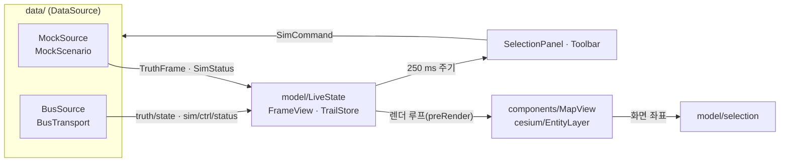

# WP5 GCS/UI (`ui/`)

TypeScript + React + CesiumJS(Vite). 모듈 코드 `UI`. `ui/monitor/`는 WP6 영역이다.

## 명령

```bash
npm install
```

```bash
npm run dev
```

```bash
npm run build
```

```bash
npm test
```

- `npm run gen:proto`: `../proto/swarm/v1` → `src/gen/` (protobuf-es). `dev`·`build`·`test` 앞에 자동으로 실행된다. `src/gen/`은 커밋하지 않는다.
- 데이터 소스 선택: `?source=mock`(기본), `?source=bus`(전송 계층 미구현, 연결 실패를 표시한다).

## 구조



- `model/`은 Cesium에 의존하지 않는다. 단위 시험은 이 계층과 `data/`를 대상으로 한다.
- 프레임마다 React를 다시 그리지 않는다. 지도는 Cesium 렌더 루프에서 `LiveState`를 읽고, 패널은 250 ms마다 다시 그린다.
- 엔티티는 Cesium Entity API 대신 Billboard·Polyline·Label 프리미티브로 직접 관리한다(엔티티 수 증가 대비).

## 오프라인 지도 (DEC-003, DEC-004, DEC-016)

- Cesium ion 등 외부 서비스에 접속하지 않는다. geocoder·base layer picker를 끈다.
- dev·preview 서버는 저장소 루트 `data/`를 `/data/`로 제공한다. 위치는 `SWARM_DATA_DIR`로 바꿀 수 있다.

| 데이터 | 기본 경로 | 판정 | 없을 때 |
|---|---|---|---|
| 영상 타일(TMS) | `data/tiles/imagery/` | `tilemapresource.xml` 존재 | Cesium 내장 Natural Earth II(저해상도) |
| 지형(quantized-mesh) | `data/tiles/terrain/` | `layer.json` 존재 | 기본 타원체 |

- 환경변수 `VITE_IMAGERY_URL`(TMS 디렉터리 또는 `{z}/{x}/{y}` 템플릿), `VITE_TERRAIN_URL`로 경로를 바꾼다.
- gzip으로 저장된 `.terrain` 파일은 `Content-Encoding: gzip`으로 제공한다(cesium-terrain-builder 산출물).

## 입력 (REQ-UI-002, PRP-UI-001)

| 입력 | 동작 |
|---|---|
| 왼쪽 클릭 | 가장 가까운 엔티티 선택(14 px 이내). 빈 곳은 선택 해제 |
| 왼쪽 드래그 | 박스 선택. 박스 안에 청군 UAV/FPV가 있으면 그것만 고른다 |
| Shift / Ctrl + 선택 | 추가 / 토글 |
| Ctrl+A, Esc | 청군 UAV/FPV 전체 선택, 선택·추종 해제 |
| 오른쪽 드래그, 휠 | 카메라 이동(3D 회전), 확대 |
| 가운데 드래그, Ctrl+오른쪽 드래그 | 기울이기 |

- 명령 전송(REQ-UI-003)과 부대 그룹 지정·호출은 다음 단계다.

## 카메라 시점 (REQ-UI-007, 구조만)

- `model/camera.ts`의 `cameraPose(entity, mode)`가 엔티티 쿼터니언(NED → FRD)에서 Cesium 카메라 자세를 만든다.
- `free`, `chase`(진행 방향 뒤·위), `fpv`(기체 자세 그대로), `gimbal`(수평 안정화 pan/tilt, 짐벌 각은 인자). 선택 패널에서 추적·1인칭을 고를 수 있다.
- 짐벌 각을 `SensorActivity`에서 받는 연동은 다음 단계다.

## 버스 연결 (제안, 다음 단계 구현)

`BusSource`는 `BusTransport`(open/subscribe/put/close)만 요구한다. 브라우저에서 Zenoh에 붙는 방식으로 두 가지를 검토했다.

| 항목 | A. zenoh-ts + zenohd remote-api 플러그인 | B. 자체 WebSocket 브리지 |
|---|---|---|
| 구성 | 브라우저 → WebSocket → zenohd(remote-api) | 브라우저 → WebSocket → 브리지 프로세스(zenoh-python 등) → Zenoh |
| DEC-002(Zenoh만) | 그대로 맞음. 키 표현식·encoding을 그대로 쓴다 | 맞음. 다만 Zenoh 위에 별도 프로토콜을 하나 더 둔다 |
| 다중 UI(DEC-020) | 각 UI가 라우터에 직접 세션을 연다 | 브리지가 연결을 관리한다 |
| 전송량 조절 | 구독 쪽에서 버린다. 서버 측 간축은 없다 | 브리지에서 truth/state 간축(예: 50 → 20 Hz)·필터 가능 |
| 유지 부담 | zenohd·remote-api 버전을 zenoh-c(WP1)와 맞춰야 한다 | 브리지 코드와 프레이밍을 직접 유지한다 |

- 제안: A를 기본으로 한다. Zenoh 의미를 그대로 쓰고 별도 서버 코드가 없다. truth/state 대역폭이 문제가 되면 같은 `BusTransport` 뒤에 B를 넣는다.
- 확정하려면 OPN 등록과 사용자 결정이 필요하다. 라우터 구성은 WP1(ZenohBus) 결과와 함께 정한다.
