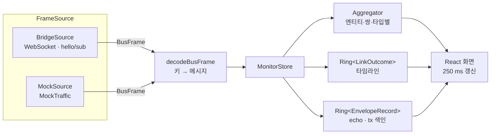

# WP6 Traffic Monitor (`ui/monitor/`)

TypeScript + React(Vite) 별도 앱. 모듈 코드 `MON`. REQ-UI-005, PRP-UI-002. 브라우저는 WebSocket 브리지로만 버스에 붙는다(DEC-027).

## 명령

```bash
npm install
```

```bash
npm run dev
```

```bash
npm test
```

```bash
npm run build
```

```bash
npm run bench
```

- `npm run gen:proto`: `../../proto/swarm/v1` → `src/gen/` (protobuf-es). `dev`·`build`·`test`·`bench` 앞에 자동 실행. `src/gen/`은 커밋하지 않는다.
- dev 서버 포트는 5174(GCS/UI 5173과 분리).

## URL 인자

| 인자 | 기본 | 의미 |
|---|---|---|
| `source` | `mock` | `mock`(내장 목 트래픽) / `bridge`(브리지 프로토콜 v1) |
| `url` | `ws://localhost:8765/bus` | 브리지 주소 |
| `replay` | – | `1`이면 SimStatus를 받기 전까지 재생(MCAP) 표시. 받은 뒤에는 `SimStatus.replay`를 따른다(DEC-031). 목 소스는 `replay=true`로 낸다. 머리줄 배지로 수동 전환 |
| `uavs`, `hz`, `rate` | 20, 10, 1 | 목 소스: UAV 수, PeerStatus 브로드캐스트 주기, 배속 |

## 구독 (브리지 프로토콜 v1, `role=observer`)

| 키 | max_hz | 용도 |
|---|---|---|
| `link/outcome/**` | 0 | 집계·타임라인 (LinkOutcome) |
| `link/state/**` | 2 | 엔티티 상세의 링크 상태 |
| `swarm/*/tx/**`, `swarm/*/rx/**` | 0 | 메시지 echo, 엔벨로프 빈도 |
| `truth/state` | 1 | 엔티티 종류·진영(트리) |
| `truth/event/**` | 0 | spawn·kill |
| `sim/ctrl/status` | 2 | 시뮬레이션 상태·시각 |

## 구조



- 프레임은 받는 즉시 동기 처리한다(outcome 1건 O(1)). 화면은 250 ms마다 보관소를 읽는다.
- 빈도·크기는 시뮬레이션 시각 5 s 이동 창, 지연·손실률·사유는 누적이다. 재생 배속과 무관하다.
- 손실률 = 손실 outcome / (전달 + 손실 outcome). 분모는 수신자별 `LinkOutcome`이다. 브로드캐스트는 닿지 않는 같은 편 수신자마다 1건이 손실로 들어온다(DEC-032). 통계 표 `거리 밖 제외`는 OUT_OF_RANGE를 분자·분모에서 뺀다.
- `sim/ctrl/status`·`truth/state` 시각이 5 s 넘게 거꾸로 가면(재생 되감기) 집계·타임라인·echo를 지운다. outcome은 데이터링크가 밀리면 늦게 오므로 되감기 판정에 쓰지 않고, 늦은 정도를 머리줄 `링크 지연`으로 보인다(1 s 초과 시). 링크 지연은 outcome을 받은 순간의 (sim 시각 − outcome tx 시각)이고, 마지막 outcome 이후 sim 시각이 5 s 넘게 흐르면 0이다. 재생 배속과 무관하다.
- 메시지 echo는 고른 항목만 `msg_type`으로 해석한다(protobuf-es registry).
- 필터는 타임라인·echo에 적용하고, 통계 표에는 엔티티 필터만 적용한다. 브로드캐스트 tx는 `송신 또는 수신` 모드에서 송신자로만 판정한다(수신 쪽은 rx 기록으로 보인다).

## 화면

| 영역 | 내용 |
|---|---|
| 머리줄 | 실시간/재생 배지(재생이면 주황 테두리), 연결 상태·계약 버전, sim 시각, SimStatus, 되감기 횟수, 링크 지연, 처리 프레임/s·처리 시간 비율, 화면 정지, 통계 초기화 |
| 필터 막대 | 엔티티(트리 체크, 송신/수신/양쪽), 인터페이스, 메시지 타입, 결과(전달·손실 사유) |
| 엔티티 트리 | 비행체/지상체 → 진영 → 엔티티. 송신 msg/s·손실률. 체크 = 필터, 클릭 = 상세 |
| 통계 표 | 송신/수신 기준 msg/s, outcome/s, 크기, 지연 평균·p95, 손실률(`거리 밖 제외` 선택), 사유별(재밍·가시선·거리·버스트·큐·고장·노드·기타) |
| 시퀀스 타임라인 | 레인 = 엔티티, 아래가 최신. 전달은 실선 화살표(tx→rx 시각), 손실은 사유 색 점선 ✕. 클릭하면 echo |
| 엔티티 상세 | 메시지 타입별 송수신, 손실이 있는 상대, link/state |
| 메시지 echo | 최근 tx/rx 엔벨로프 목록과 LinkEnvelope·payload 해석 |

## 목 트래픽 (`src/mock/`)

GCS 1, UAV 20(4개 원 궤도), 재밍기지·표적 4. PeerStatus(p2p 브로드캐스트), TrackShare, TaskStatus·SensorActivity(→GCS), TaskCommand·RoutePlan(GCS→). 손실 사유가 모두 나오도록 단순화한 링크 모델이다.

| 사유 | 목 조건 |
|---|---|
| 재밍 | 60 s 주기 중 10–50 s, `site-01` 반경 2.5 km 안 |
| 가시선 | GCS 기준 방위 200–230°, 6 km 너머 |
| 거리 | p2p 14 km, GCS 18 km 초과 |
| 버스트 | Gilbert-Elliott(쌍별) |
| 큐 | 송신자 토큰 버킷 6000 B/s. 20 s마다 GCS RoutePlan 일괄 전송 |
| 고장 | `uav-007` 120 s 주기 중 30–40 s 모든 링크 |
| 노드 | `uav-020` 90 s에 파괴(truth/event/kill) |
